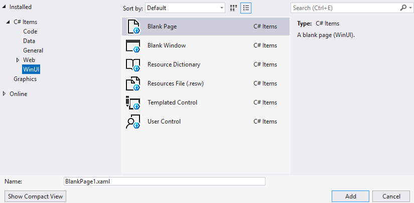

# Visual Studio for Windows app development

[Visual Studio](https://visualstudio.microsoft.com/) is the recommended IDE for building Windows apps with [WinUI](/windows/apps/winui/) and the [Windows App SDK](/windows/apps/windows-app-sdk/). It provides deep integration with the Windows platform and tools purpose-built for XAML-based app development.

Key features for Windows app developers include:

- **XAML Hot Reload** — modify XAML markup while your app is running and see changes applied instantly without restarting
- **XAML Live Visual Tree** — inspect the runtime visual tree of your running app to debug layout issues and understand element hierarchy
- **IntelliSense for XAML and C#/C++** — get code completion, quick info, and error highlighting for both markup and code-behind
- **Integrated debugging** — set breakpoints in XAML and code, inspect data bindings, and diagnose UI rendering issues

To get started, see [Create and run a WinUI 3 project](../get-started/start-here.md).

## WinUI project templates

Visual Studio includes project templates to help you quickly create WinUI apps. To find them, open **File** > **New** > **Project**, then filter by **WinUI** in the project type drop-down or search for *WinUI*.

:::image type="content" source="../winui/winui3/images/WinUI3-csharp-newproject-1.0-later.png" alt-text="WinUI project templates" border="true":::

### App templates

Choose a template based on the app shell you want to start from. Select a template name to see a screenshot of the app it creates.

| Template | Language | winapp CLI template | Description |
|----------|----------|---------------------|-------------|
| [WinUI Blank App (Packaged)](#winui-blank-app-packaged) | C# and C++ | `winui` (C#) | A single window with no content. This is the recommended starting point for most new apps. |
| [WinUI Navigation App](#winui-navigation-app) | C# | `winui-navview` | A **NavigationView** shell with Home, About, and Settings pages. |
| [WinUI TabView App](#winui-tabview-app) | C# | `winui-tabview` | A **TabView** shell whose tabs are in the title bar. |
| [WinUI MVVM App](#winui-mvvm-app) | C# | `winui-mvvm` | A page and view model that use the Model-View-ViewModel (MVVM) pattern with [CommunityToolkit.Mvvm](/dotnet/communitytoolkit/mvvm/). |
| [Blank App (Packaged with WAP Project)](#blank-app-packaged-with-wap-project) | C# and C++ | Not available | A blank app plus a separate Windows Application Packaging Project. |

### Create a project from the command line

The C# app templates are also available from the terminal through the [Windows App Development CLI (winapp CLI)](winapp-cli/index.md). Pass the template name from the table to `winapp new`, then build and launch the app with `winapp run`:

```powershell
winapp new --name MyApp --template winui-navview --use-defaults
cd MyApp
winapp run
```

Run `winapp new --list` to see every installed template. The generated project is a standard .csproj, so you can open it in Visual Studio at any time. For more information, see [Using winapp CLI with WinUI](winapp-cli/guides/winui.md).

### WinUI Blank App (Packaged)

Creates a desktop app in C# (.NET) or C++ (Win32) with a WinUI-based UI. The project starts with a single window derived from **Microsoft.UI.Xaml.Window**, ready for you to add your own controls and pages. This is the recommended starting point for most new apps. For a walkthrough, see [Create and run a WinUI 3 project](../get-started/start-here.md).

:::image type="content" source="images/winui-templates/blank-app.png" alt-text="An app created from the WinUI Blank App template, showing an empty window with a title bar." border="true":::

### WinUI Navigation App

Creates a C# app with a [NavigationView](../develop/ui/controls/navigationview.md) in the left pane. The template includes Home and About pages, a Settings item, and the navigation code that switches between them.

:::image type="content" source="images/winui-templates/navigation-app.png" alt-text="An app created from the WinUI Navigation App template, showing a navigation pane with Home, About, and Settings items and the Home page." border="true":::

### WinUI TabView App

Creates a C# app with a [TabView](../develop/ui/controls/tab-view.md) that extends into the title bar. The template includes Home and About tabs and a button for adding new tabs.

:::image type="content" source="images/winui-templates/tab-view-app.png" alt-text="An app created from the WinUI TabView App template, showing Home and About tabs in the title bar." border="true":::

### WinUI MVVM App

Creates a C# app that separates UI from logic with the MVVM pattern. The template uses [CommunityToolkit.Mvvm](/dotnet/communitytoolkit/mvvm/) for observable properties and commands, and shows a counter that's bound to a view model.

:::image type="content" source="images/winui-templates/mvvm-app.png" alt-text="An app created from the WinUI MVVM App template, showing a Hello, WinUI! heading and a counter with increment and decrement buttons." border="true":::

### Blank App (Packaged with WAP Project)

Same as the WinUI Blank App (Packaged) template above, but adds a separate [Windows Application Packaging Project](/windows/msix/desktop/desktop-to-uwp-packaging-dot-net) to the solution. This project handles building your app into an [MSIX package](/windows/msix/overview) for distribution. If you prefer a simpler setup, you can use [single-project MSIX](../windows-app-sdk/single-project-msix.md) instead to avoid maintaining the separate packaging project.

### Component and test templates

These templates create libraries and test projects that work alongside a WinUI app.

| Template | Language | winapp CLI template | Description |
|----------|----------|---------------------|-------------|
| **WinUI Class Library** | C# | `winui-lib` | A .NET class library (DLL) for sharing code and UI components across WinUI apps. |
| **Windows Runtime Component** | C++ | Not available | A [Windows Runtime component](/windows/uwp/winrt-components/) written in C++/WinRT that can be consumed by any app with a WinUI-based UI, regardless of programming language. |
| **WinUI Unit Test App** | C# and C++ | `winui-unittest` (C#) | An MSTest project for writing and running automated tests against your app. |

## WinUI item templates

Item templates let you add new files to an existing WinUI project. Right-click your project in **Solution Explorer**, select **Add** > **New Item**, and choose the **WinUI** tab.



| Template | Language | Description |
|----------|----------|-------------|
| Blank Page | C# and C++ | Adds a XAML file and code file that defines a new page derived from the **Microsoft.UI.Xaml.Controls.Page** class. |
| Blank Window | C# and C++ | Adds a XAML file and code file that defines a new window derived from the **Microsoft.UI.Xaml.Window** class. |
| Content Dialog | C# | Adds a XAML file and code file that defines a new dialog derived from the **Microsoft.UI.Xaml.Controls.ContentDialog** class. For more information, see [Dialog controls](../develop/ui/controls/dialogs-and-flyouts/dialogs.md). |
| Resource Dictionary | C# and C++ | Adds an empty, keyed collection of XAML resources. For more information, see [ResourceDictionary and XAML resource references](../develop/platform/xaml/xaml-resource-dictionary.md). |
| Resources File (.resw) | C# and C++ | Adds a file for storing string and conditional resources for your app. You can use this item to help localize your app. For more info, see [Localize strings in your UI and app package manifest](/windows/uwp/app-resources/localize-strings-ui-manifest). |
| Templated Control | C# and C++ | Adds a code file for creating a templated control with a default style. The templated control is derived from the **Microsoft.UI.Xaml.Controls.Control** class.<p></p>For a walkthrough that demonstrates how to use this item template, see [Build XAML templated controls](../winui/winui3/xaml-templated-controls-winui-3.md). For more information about templated controls, see [Custom XAML Controls](/archive/msdn-magazine/2019/may/xaml-custom-xaml-controls). |
| User Control | C# and C++ | Adds a XAML file and code file for creating a user control that derives from the **Microsoft.UI.Xaml.Controls.UserControl** class. Typically, a user control encapsulates related existing controls and provide its own logic.<p></p>For more information about user controls, see [Custom XAML Controls](/archive/msdn-magazine/2019/may/xaml-custom-xaml-controls). |

To add these items from the command line in a C# project, use the matching `dotnet new` item template, such as `dotnet new winui-page -n SettingsPage`. Run `dotnet new list winui` to see all item templates.


## See also

* [Windows App SDK](../windows-app-sdk/index.md)
* [Create and run a WinUI 3 project](../get-started/start-here.md)
* [Windows App SDK Samples](https://github.com/microsoft/WindowsAppSDK-Samples)
