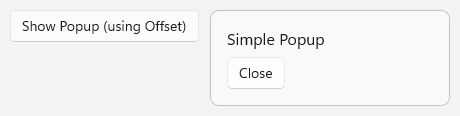

# Popup

A popup displays content on top of the other UI in your app. The [Popup](/windows/windows-app-sdk/api/winrt/microsoft.ui.xaml.controls.primitives.popup) class in the `Microsoft.UI.Xaml.Controls.Primitives` namespace is a general-purpose container for that content. It has no default visual template, so you provide the content, its appearance, and the logic that opens and closes it.

`Popup` is a low-level building block. WinUI also provides controls for common kinds of transient UI, such as flyouts, dialogs, teaching tips, and tooltips. Those controls include their own styling, placement, and dismissal behavior.



## Is this the right control?

Don't use a `Popup` if a higher-level control fits your scenario. Use these controls instead:

| Scenario | Control |
|---|---|
| Show information or collect input related to an item, in UI that closes when the user clicks outside it. | [Flyout](flyouts.md) |
| Show a list of commands or options. | [MenuFlyout](../menus.md) |
| Ask a question, or show information that the user must respond to before they continue. | [ContentDialog](dialogs.md) |
| Point out a new or important feature, with or without targeting a specific element. | [TeachingTip](teaching-tip.md) |
| Show a short description of an element when the user hovers over it or moves focus to it. | [ToolTip](../tooltips.md) |

Use a `Popup` when you need custom content that floats above your UI and none of these controls meets your needs. For example, you might use a popup for an overlay that you style and position yourself.

A popup isn't modal, so the user can still interact with the UI behind it. If the user must respond before they continue, use a [ContentDialog](dialogs.md).

## Recommendations

- Give the popup content a background, a border, and rounded corners so that it stands out from the UI behind it. The WinUI 3 Gallery sample uses the `AcrylicBackgroundFillColorDefaultBrush`, `SurfaceStrokeColorDefaultBrush`, and `OverlayCornerRadius` resources. For more info, see [Acrylic material](../../../../design/style/acrylic.md) and [ThemeShadow in Popups](../../shadows.md#themeshadow-in-popups).
- If you don't enable [light dismiss](#close-a-popup-with-light-dismiss), include a button or another control that closes the popup.
- Keep popup content brief and focused on a single task.

## Create a popup

> [!div class="checklist"]
>
> - **Important APIs**: [Popup class](/windows/windows-app-sdk/api/winrt/microsoft.ui.xaml.controls.primitives.popup), [IsOpen property](/windows/windows-app-sdk/api/winrt/microsoft.ui.xaml.controls.primitives.popup.isopen), [Child property](/windows/windows-app-sdk/api/winrt/microsoft.ui.xaml.controls.primitives.popup.child)

> [!div class="nextstepaction"]
> [Open the WinUI 3 Gallery app and see the Popup in action](winui3gallery://item/Popup)

[!INCLUDE [winui-3-gallery](../../../../../includes/winui-3-gallery.md)]

A popup hosts a single element, which you set as its [Child](/windows/windows-app-sdk/api/winrt/microsoft.ui.xaml.controls.primitives.popup.child). The child is usually a panel, or a `UserControl` that defines the popup content. To show the popup, set [IsOpen](/windows/windows-app-sdk/api/winrt/microsoft.ui.xaml.controls.primitives.popup.isopen) to `true`. To hide it, set `IsOpen` to `false`.

This example is based on the WinUI 3 Gallery sample. It declares a popup next to the button that opens it, and the popup content includes a button that closes the popup.

```xaml
<Grid HorizontalAlignment="Left" VerticalAlignment="Top">
    <Button Content="Show popup" Click="ShowPopupClicked" />
    <Popup x:Name="StandardPopup" HorizontalOffset="200" VerticalOffset="0">
        <Grid MinWidth="240"
              Padding="16"
              Background="{ThemeResource AcrylicBackgroundFillColorDefaultBrush}"
              BorderBrush="{ThemeResource SurfaceStrokeColorDefaultBrush}"
              BorderThickness="1"
              CornerRadius="{StaticResource OverlayCornerRadius}">
            <StackPanel Spacing="8">
                <TextBlock FontSize="16" Text="Simple popup" />
                <Button Content="Close" Click="ClosePopupClicked" />
            </StackPanel>
        </Grid>
    </Popup>
</Grid>
```

```csharp
// Opens the popup if it isn't already open.
private void ShowPopupClicked(object sender, RoutedEventArgs e)
{
    if (!StandardPopup.IsOpen)
    {
        StandardPopup.IsOpen = true;
    }
}

// Closes the popup when the user clicks the Close button inside it.
private void ClosePopupClicked(object sender, RoutedEventArgs e)
{
    if (StandardPopup.IsOpen)
    {
        StandardPopup.IsOpen = false;
    }
}
```

### Create a popup in code

You can also create a popup in code without adding it to the visual tree. A popup that you declare in XAML, or add to a panel in the visual tree, gets its [XamlRoot](/windows/windows-app-sdk/api/winrt/microsoft.ui.xaml.uielement.xamlroot) from its parent element. A popup that has no parent doesn't, so you must set its `XamlRoot` property before you open it.

```csharp
private Popup? _popup;

private void ShowPopupFromCodeClicked(object sender, RoutedEventArgs e)
{
    _popup ??= new Popup
    {
        // PopupContent is a UserControl in your app that defines the popup content.
        Child = new PopupContent(),
        IsLightDismissEnabled = true,

        // Required because this popup isn't in the visual tree. Use the XamlRoot
        // of an element that's already loaded, such as the button that was clicked.
        XamlRoot = ((UIElement)sender).XamlRoot
    };

    _popup.IsOpen = true;
}
```

> [!IMPORTANT]
> In WinUI 3, opening a popup that has neither a parent element nor a `XamlRoot` fails. An element's `XamlRoot` is `null` until the element is added to the live visual tree, so get the value from an element that's already loaded, rather than in a page constructor. In a `Window` class, you can use `this.Content.XamlRoot`. For more info, see [ContentDialog, and Popup](../../../../windows-app-sdk/migrate-to-windows-app-sdk/guides/winui3.md#contentdialog-and-popup).

> [!NOTE]
> A popup that isn't in the visual tree doesn't reposition itself when the touch keyboard appears, so the keyboard can cover it. If the popup contains text input controls, such as a `TextBox`, declare the popup in XAML or add it to a panel in the visual tree.

## Close a popup with light dismiss

By default, a popup stays open until your code sets `IsOpen` to `false`. Set [IsLightDismissEnabled](/windows/windows-app-sdk/api/winrt/microsoft.ui.xaml.controls.primitives.popup.islightdismissenabled) to `true` to close the popup when the user clicks or taps outside it, or presses the Esc key. This behavior is called *light dismiss*.

By default, the area outside a light-dismiss popup isn't darkened. To darken it, set [LightDismissOverlayMode](/windows/windows-app-sdk/api/winrt/microsoft.ui.xaml.controls.primitives.popup.lightdismissoverlaymode) to `On`. This property has no effect when `IsLightDismissEnabled` is `false`.

```xaml
<Popup x:Name="LightDismissPopup"
       IsLightDismissEnabled="True"
       LightDismissOverlayMode="On">
    <Border Padding="16"
            Background="{ThemeResource AcrylicBackgroundFillColorDefaultBrush}"
            BorderBrush="{ThemeResource SurfaceStrokeColorDefaultBrush}"
            BorderThickness="1"
            CornerRadius="{StaticResource OverlayCornerRadius}">
        <TextBlock Text="Click outside this popup or press Esc to close it." />
    </Border>
</Popup>
```

## Position a popup

You can position a popup by using offsets, or relative to another element.

### Use offsets

[HorizontalOffset](/windows/windows-app-sdk/api/winrt/microsoft.ui.xaml.controls.primitives.popup.horizontaloffset) and [VerticalOffset](/windows/windows-app-sdk/api/winrt/microsoft.ui.xaml.controls.primitives.popup.verticaloffset) set the position of the popup, in pixels. The point that the offsets are measured from depends on whether the popup has a parent:

- A popup in the visual tree is offset from its own position in the layout of its parent. For example, in a vertical `StackPanel`, that position is below the elements that come before the popup. In the [first example](#create-a-popup), the popup shares a single-cell `Grid` with the button, so it appears 200 pixels to the right of the top-left corner of the `Grid`.
- A popup that has no parent, such as one that you [create in code](#create-a-popup-in-code), is offset from the top-left corner of its XAML root, which is usually the content area of your app window.

### Place a popup next to an element

To show a popup next to a specific element, set [PlacementTarget](/windows/windows-app-sdk/api/winrt/microsoft.ui.xaml.controls.primitives.popup.placementtarget) to that element. Then set [DesiredPlacement](/windows/windows-app-sdk/api/winrt/microsoft.ui.xaml.controls.primitives.popup.desiredplacement) to a [PopupPlacementMode](/windows/windows-app-sdk/api/winrt/microsoft.ui.xaml.controls.primitives.popupplacementmode) value other than `Auto`, such as `Bottom` or `RightEdgeAlignedTop`.

When the popup opens, the framework positions it relative to the target element. If the popup doesn't fit in the preferred position, the framework moves it to the opposite side of the target. `HorizontalOffset` and `VerticalOffset` still apply, and shift the popup from the calculated position.

[ActualPlacement](/windows/windows-app-sdk/api/winrt/microsoft.ui.xaml.controls.primitives.popup.actualplacement) reports where the popup is shown. The [ActualPlacementChanged](/windows/windows-app-sdk/api/winrt/microsoft.ui.xaml.controls.primitives.popup.actualplacementchanged) event occurs when that value changes while the popup is open.

```xaml
<StackPanel Spacing="8">
    <Button x:Name="DetailsButton" Content="Show details" Click="ShowDetailsClicked" />
    <TextBlock x:Name="PlacementStatus" />
    <Popup x:Name="DetailsPopup"
           PlacementTarget="{x:Bind DetailsButton}"
           DesiredPlacement="BottomEdgeAlignedLeft"
           IsLightDismissEnabled="True"
           ActualPlacementChanged="DetailsPopup_ActualPlacementChanged">
        <Border Padding="16"
                Background="{ThemeResource AcrylicBackgroundFillColorDefaultBrush}"
                BorderBrush="{ThemeResource SurfaceStrokeColorDefaultBrush}"
                BorderThickness="1"
                CornerRadius="{StaticResource OverlayCornerRadius}">
            <TextBlock Text="This popup appears below the button when there's room." />
        </Border>
    </Popup>
</StackPanel>
```

```csharp
private void ShowDetailsClicked(object sender, RoutedEventArgs e)
{
    DetailsPopup.IsOpen = true;
}

private void DetailsPopup_ActualPlacementChanged(object sender, object e)
{
    // ActualPlacement differs from DesiredPlacement when the popup
    // doesn't fit in the preferred position.
    PlacementStatus.Text = $"Actual placement: {DetailsPopup.ActualPlacement}";
}
```

### Show a popup outside the app window

By default, a popup is constrained to the bounds of its XAML root, which is usually the content area of your app window. Starting in Windows App SDK 1.4, you can set [ShouldConstrainToRootBounds](/windows/windows-app-sdk/api/winrt/microsoft.ui.xaml.controls.primitives.popup.shouldconstraintorootbounds) to `false` to let the popup extend beyond the window. For example, you might do this when the popup is larger than a small window.

Set `ShouldConstrainToRootBounds` before you open the popup for the first time. You can't change it after the popup has been opened.

```xaml
<Popup x:Name="UnconstrainedPopup" ShouldConstrainToRootBounds="False">
    <!-- Popup content -->
</Popup>
```

## Animate a popup

To animate the popup content when it appears, add a transition to the [ChildTransitions](/windows/windows-app-sdk/api/winrt/microsoft.ui.xaml.controls.primitives.popup.childtransitions) collection. [PopupThemeTransition](/windows/windows-app-sdk/api/winrt/microsoft.ui.xaml.media.animation.popupthemetransition) provides the animation for pop-in UI, such as tooltip-like content, as it appears.

```xaml
<Popup x:Name="AnimatedPopup" IsLightDismissEnabled="True">
    <Popup.ChildTransitions>
        <TransitionCollection>
            <PopupThemeTransition />
        </TransitionCollection>
    </Popup.ChildTransitions>
    <Border Padding="16"
            Background="{ThemeResource AcrylicBackgroundFillColorDefaultBrush}"
            BorderBrush="{ThemeResource SurfaceStrokeColorDefaultBrush}"
            BorderThickness="1"
            CornerRadius="{StaticResource OverlayCornerRadius}">
        <TextBlock Text="This content animates when the popup opens." />
    </Border>
</Popup>
```

To control the show and hide animations from a storyboard instead, use `PopInThemeAnimation` and `PopOutThemeAnimation`. For more info, see [Show/hide popup](../../../motion/xaml-animation.md#show-hide-popup).

## Respond when a popup opens or closes

The [Opened](/windows/windows-app-sdk/api/winrt/microsoft.ui.xaml.controls.primitives.popup.opened) event occurs when `IsOpen` is set to `true`. The [Closed](/windows/windows-app-sdk/api/winrt/microsoft.ui.xaml.controls.primitives.popup.closed) event occurs when `IsOpen` is set to `false`, including when the popup closes through light dismiss. Use `Closed` for work that needs to happen however the popup closes. For example, the WinUI 3 Gallery sample uses `Closed` to re-enable a setting that it disables while the popup is open.

Both events use `EventHandler<object>`, so your handlers take an `object` sender and an `object` event argument.

```xaml
<StackPanel Spacing="8">
    <TextBlock x:Name="StatusText" />
    <Popup x:Name="StatusPopup"
           IsLightDismissEnabled="True"
           Opened="StatusPopup_Opened"
           Closed="StatusPopup_Closed">
        <!-- Popup content -->
    </Popup>
</StackPanel>
```

```csharp
private void StatusPopup_Opened(object sender, object e)
{
    StatusText.Text = "The popup is open.";
}

private void StatusPopup_Closed(object sender, object e)
{
    // Closed occurs for every close, including light dismiss.
    StatusText.Text = "The popup is closed.";
}
```

## Keyboard, focus, and accessibility

- When light dismiss is enabled, opening the popup moves focus into it, and closing the popup returns focus to the element that had focus before. The user can also press Esc to close the popup.
- When light dismiss isn't enabled, the popup doesn't move focus when it opens. Move focus to an element in the popup after you open it, include a **Close** button that keyboard users can reach, and return focus to the element that opened the popup after it closes.
- A popup doesn't raise routed events, such as `KeyDown` and `PointerPressed`. To handle these events, attach the handlers to the popup's child element instead.
- Make sure that each interactive element in the popup has an accessible name. For more info, see [Keyboard accessibility](../../../../design/accessibility/keyboard-accessibility.md) and [Expose basic accessibility information](../../../../design/accessibility/basic-accessibility-information.md).

## Related articles

- [Dialogs and flyouts](index.md)
- [Flyouts](flyouts.md)
- [Dialog controls](dialogs.md)
- [Teaching tip](teaching-tip.md)
- [Tooltips](../tooltips.md)
- [Shadows in Windows apps](../../shadows.md)
- [Popup class](/windows/windows-app-sdk/api/winrt/microsoft.ui.xaml.controls.primitives.popup)
