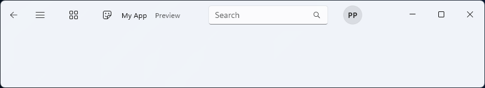
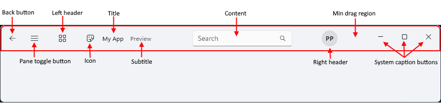

# Title bar

The TitleBar control provides a simplified way to create a custom title bar for your app. The title bar is a fundamental component of a Windows app's user interface that identifies the app via its icon and title, houses the system caption buttons that let a user close, maximize, minimize, and restore the window, and lets a user drag the window around the screen.

You can use a custom title bar to better integrate the title bar area with your app UI. The title bar can be customized to match the app's visual style using Mica theming. It can include other relevant information, such as a document title or the current state (e.g., “Editing,” “Viewing,” etc.). It can also host other WinUI 3 controls, like AutoSuggestBox and PersonPicture, providing a cohesive user experience for your app.



## Is this the right control?

Use the TitleBar control when you want to integrate the title bar area with your app UI using customizations such as subtitles, [Mica](../../../design/style/mica.md) theming, and integrations with WinUI controls.

## Anatomy

By default, the title bar shows only the system caption buttons. Other parts of the title bar are shown or hidden depending on associated property settings.

The title bar is divided into these areas:



- **Back button:** [IsBackButtonEnabled](/windows/windows-app-sdk/api/winrt/microsoft.ui.xaml.controls.titlebar.isbackbuttonenabled), [IsBackButtonVisible](/windows/windows-app-sdk/api/winrt/microsoft.ui.xaml.controls.titlebar.isbackbuttonvisible), [BackRequested](/windows/windows-app-sdk/api/winrt/microsoft.ui.xaml.controls.titlebar.backrequested) - A built-in back button for navigation.
- **Pane toggle button:** [IsPaneToggleButtonVisible](/windows/windows-app-sdk/api/winrt/microsoft.ui.xaml.controls.titlebar.ispanetogglebuttonvisible), [PaneToggleRequested](/windows/windows-app-sdk/api/winrt/microsoft.ui.xaml.controls.titlebar.panetogglerequested) - This button is intended to be used in conjunction with the NavigationView control.
- **Left header:** [LeftHeader](/windows/windows-app-sdk/api/winrt/microsoft.ui.xaml.controls.titlebar.leftheader)
- **Icon:** [IconSource](/windows/windows-app-sdk/api/winrt/microsoft.ui.xaml.controls.titlebar.iconsource)
- **Title:** [Title](/windows/windows-app-sdk/api/winrt/microsoft.ui.xaml.controls.titlebar.title)
- **Subtitle:** [Subtitle](/windows/windows-app-sdk/api/winrt/microsoft.ui.xaml.controls.titlebar.subtitle)
- **Content:** [Content](/windows/windows-app-sdk/api/winrt/microsoft.ui.xaml.controls.titlebar.content)
- **Right header:** [RightHeader](/windows/windows-app-sdk/api/winrt/microsoft.ui.xaml.controls.titlebar.rightheader)
- **Min drag region:** This area is reserved next to the system caption buttons so that the user always has a place to grab the window for dragging.
- **System caption buttons:** These buttons are not part of the TitleBar control - it simply allocates space where the caption buttons appear, depending on RTL or LTR settings. Caption buttons and customizations are handled by the [AppWindowTitleBar](/windows/windows-app-sdk/api/winrt/microsoft.ui.windowing.appwindowtitlebar).

The layout is reversed when the [FlowDirection](/windows/windows-app-sdk/api/winrt/microsoft.ui.xaml.frameworkelement.flowdirection) is **RightToLeft**.

## Create a title bar

> [!div class="checklist"]
>
> - **Important APIs:** [TitleBar class](/windows/windows-app-sdk/api/winrt/microsoft.ui.xaml.controls.titlebar), [Title property](/windows/windows-app-sdk/api/winrt/microsoft.ui.xaml.controls.titlebar.title)

> [!div class="nextstepaction"]
> [Open the WinUI 3 Gallery app and see the TitleBar in action](winui3gallery://item/TitleBar)

[!INCLUDE [winui-3-gallery](../../../../includes/winui-3-gallery.md)]

This example creates a simple title bar that replaces the system title bar. It has a title, icon, and Mica theming.

```xaml
<Window
    ...  >
    <Window.SystemBackdrop>
        <MicaBackdrop Kind="Base"/>
    </Window.SystemBackdrop>

    <Grid>
        <Grid.RowDefinitions>
            <RowDefinition Height="Auto" />
            <RowDefinition Height="*" />
        </Grid.RowDefinitions>

        <TitleBar x:Name="SimpleTitleBar"
                  Title="My App">
            <TitleBar.IconSource>
                <FontIconSource Glyph="&#xF4AA;"/>
            </TitleBar.IconSource>
        </TitleBar>

        <!-- App content -->
        <Frame x:Name="RootFrame" Grid.Row="1"/>
    </Grid>
</Window>
```

```csharp
public MainWindow()
{
    this.InitializeComponent();

    // Hides the default system title bar.
    ExtendsContentIntoTitleBar = true;
    // Replace system title bar with the WinUI TitleBar control. 
    SetTitleBar(SimpleTitleBar); 
}

```

## Integration with NavigationView

The [Navigation view](navigationview.md) has a built-in back button and pane toggle button. Fluent Design guidance recommends that these controls be placed in the title bar when a custom title bar is used.

This example demonstrates how to integrate the TitleBar control with a NavigationView control by hiding the back button and pane toggle button in the navigation view and using the corresponding buttons on the title bar instead.

```xaml
<Grid>
    <Grid.RowDefinitions>
        <RowDefinition Height="Auto" />
        <RowDefinition Height="*" />
    </Grid.RowDefinitions>

    <TitleBar Title="My App"
              IsBackButtonVisible="True"
              IsBackButtonEnabled="{x:Bind RootFrame.CanGoBack, Mode=OneWay}"
              BackRequested="TitleBar_BackRequested"
              IsPaneToggleButtonVisible="True"
              PaneToggleRequested="TitleBar_PaneToggleRequested">
    </TitleBar>

    <NavigationView x:Name="RootNavigationView" Grid.Row="1"
                    IsBackButtonVisible="Collapsed"
                    IsPaneToggleButtonVisible="False">
        <Frame x:Name="RootFrame" />
    </NavigationView>
</Grid>
```

```csharp
private void TitleBar_BackRequested(TitleBar sender, object args)
{
    if (RootFrame.CanGoBack)
    {
        RootFrame.GoBack();
    }
}

private void TitleBar_PaneToggleRequested(TitleBar sender, object args)
{
    RootNavigationView.IsPaneOpen = !RootNavigationView.IsPaneOpen;
}

```

## Customize drag regions

Users move a window by dragging its title bar. The TitleBar control determines which parts of its [Content](/windows/windows-app-sdk/api/winrt/microsoft.ui.xaml.controls.titlebar.content) area users can drag and which parts receive pointer input, such as clicks.

Starting in Windows App SDK 2.1.3, the TitleBar control examines the elements in its content and excludes only interactive controls, such as buttons, text boxes, and combo boxes, from the drag region. Empty space and non-interactive elements, such as a TextBlock, are draggable by default, so you don't need to change your markup. In earlier versions, empty space in the content area could block window dragging. This default behavior is the `TitleBar_ContentDragRegions` runtime compatibility change. For more info, see [RuntimeCompatibilityOptions.DisabledChanges](/windows/windows-app-sdk/api/winrt/microsoft.windows.applicationmodel.windowsappruntime.runtimecompatibilityoptions.disabledchanges).

> [!div class="checklist"]
>
> - **Important APIs:** [TitleBar.IsDragRegion attached property](/windows/windows-app-sdk/api/winrt/microsoft.ui.xaml.controls.titlebar.isdragregion), [AutoRefreshDragRegions property](/windows/windows-app-sdk/api/winrt/microsoft.ui.xaml.controls.titlebar.autorefreshdragregions), [RecomputeDragRegions method](/windows/windows-app-sdk/api/winrt/microsoft.ui.xaml.controls.titlebar.recomputedragregions)

The following example is based on the WinUI 3 Gallery sample. The title bar content is a Grid that contains an AutoSuggestBox and a Button. Both controls are clickable, and the empty space next to them is draggable.

```xaml
<TitleBar x:Name="AppTitleBar" Title="My App">
    <TitleBar.Resources>
        <!-- Stretch the content across the available width of the title bar. -->
        <HorizontalAlignment x:Key="TitleBarContentHorizontalAlignment">Stretch</HorizontalAlignment>
    </TitleBar.Resources>
    <TitleBar.Content>
        <Grid ColumnSpacing="8">
            <Grid.ColumnDefinitions>
                <ColumnDefinition Width="*" />
                <ColumnDefinition Width="Auto" />
            </Grid.ColumnDefinitions>

            <AutoSuggestBox MaxWidth="580"
                            VerticalAlignment="Center"
                            PlaceholderText="Search..."
                            QueryIcon="Find" />

            <StackPanel x:Name="RightPanel"
                        Grid.Column="1"
                        Orientation="Horizontal"
                        Spacing="8"
                        VerticalAlignment="Center">
                <Button x:Name="StatusButton"
                        Content="Status"
                        Click="StatusButton_Click" />
            </StackPanel>
        </Grid>
    </TitleBar.Content>
</TitleBar>
```

### Override the drag behavior of an element

To override the default behavior for an element in the title bar content, set the [TitleBar.IsDragRegion](/windows/windows-app-sdk/api/winrt/microsoft.ui.xaml.controls.titlebar.isdragregion) attached property. The property is a nullable Boolean value.

| Value | Behavior |
|---|---|
| Not set (`null`) | The TitleBar control decides. Interactive controls are clickable, and other elements are draggable. |
| `True` | The element is draggable, even if it's an interactive control. Pointer input on the element moves the window, so users can't click the element. |
| `False` | The element is clickable, even if it isn't an interactive control. |

You can set the property on a panel, such as a StackPanel:

- If you set it to `False`, the whole area of the panel is clickable, including the space between its children.
- If you set it to `True`, the panel and its children are draggable, except for children where you set the property to `False`.

Set the property on the smallest element that needs it, so that you don't make a large area of the title bar draggable or clickable by accident.

This example makes a group of formatting controls clickable as a whole, so that users don't drag the window when they press the space between the controls.

```xaml
<StackPanel Orientation="Horizontal" Spacing="8" TitleBar.IsDragRegion="False">
    <ComboBox PlaceholderText="Font" />
    <ComboBox PlaceholderText="Size" />
    <ToggleButton Content="Bold" />
</StackPanel>
```

In code, call [SetIsDragRegion](/windows/windows-app-sdk/api/winrt/microsoft.ui.xaml.controls.titlebar.setisdragregion) to set the value, and call `ClearValue` with [IsDragRegionProperty](/windows/windows-app-sdk/api/winrt/microsoft.ui.xaml.controls.titlebar.isdragregionproperty) to return to the default behavior. To read the value, call [GetIsDragRegion](/windows/windows-app-sdk/api/winrt/microsoft.ui.xaml.controls.titlebar.getisdragregion). It returns `null` if the property isn't set. When the value changes, the TitleBar control updates its drag regions.

```csharp
// Make the button draggable. Users can't click it.
TitleBar.SetIsDragRegion(StatusButton, true);

// Make the button clickable.
TitleBar.SetIsDragRegion(StatusButton, false);

// Clear the value so that the TitleBar control decides.
StatusButton.ClearValue(TitleBar.IsDragRegionProperty);
```

### Update drag regions when the content changes

The TitleBar control updates its drag regions when you set or replace its content, when the content loads, when the title bar changes size, and when the value of `TitleBar.IsDragRegion` changes on an element.

If you add, remove, or resize elements in the title bar content at run time, call [RecomputeDragRegions](/windows/windows-app-sdk/api/winrt/microsoft.ui.xaml.controls.titlebar.recomputedragregions) after you make the change.

```csharp
private void AddButton_Click(object sender, RoutedEventArgs e)
{
    RightPanel.Children.Insert(0, new Button { Content = "Extra" });

    // Update the drag regions so that the new button is clickable.
    AppTitleBar.RecomputeDragRegions();
}
```

If the title bar content changes often, you can set [AutoRefreshDragRegions](/windows/windows-app-sdk/api/winrt/microsoft.ui.xaml.controls.titlebar.autorefreshdragregions) to `True` instead. The TitleBar control then updates its drag regions after every layout pass. This option can affect performance, so it's `False` by default.

```xaml
<TitleBar x:Name="AppTitleBar" Title="My App" AutoRefreshDragRegions="True">
    <!-- Title bar content that changes at run time. -->
</TitleBar>
```

> [!NOTE]
> Drag regions affect pointer input only. They don't change keyboard focus or how UI Automation clients, such as screen readers, interact with the elements in the title bar. Make sure that the interactive controls in your title bar can still be reached with the keyboard.

If your app doesn't use the TitleBar control, use the [InputNonClientPointerSource](/windows/windows-app-sdk/api/winrt/microsoft.ui.input.inputnonclientpointersource) class to set the interactive regions of your custom title bar. For more info, see [Interactive content](../../title-bar.md#interactive-content).

## Related articles

- [Title bar (design)](../../../design/basics/titlebar-design.md)
- [Title bar customization](../../title-bar.md)
- [TitleBar class](/windows/windows-app-sdk/api/winrt/microsoft.ui.xaml.controls.titlebar)
