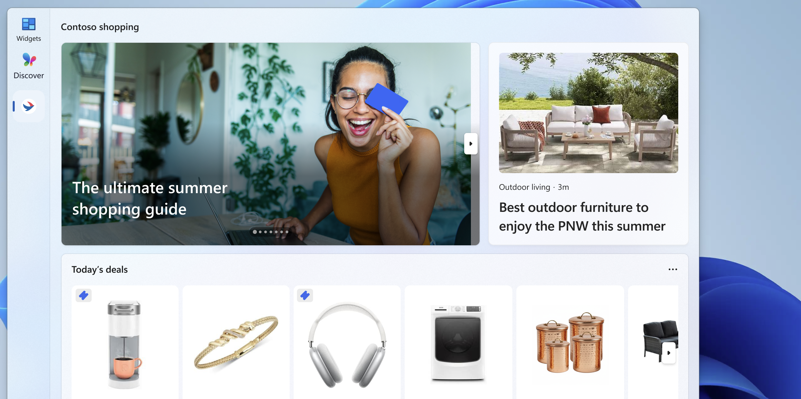

# Develop Windows Widgets and Dashboards

## Widgets

Windows widgets are small UI containers associated with an installed app. The Widgets Board displays them in a grid over the Windows desktop, with personalized content and quick actions from your app. You can define content with [Adaptive Cards](https://adaptivecards.io/), which bind data to a JSON template, or display HTML from a URL with a [web widget provider](web-widget-providers.md). Web widgets still use an Adaptive Card JSON payload to specify the content URL.

:::image type="content" source="../../design/widgets/images/widgets-hero-image.png" alt-text="Screenshot of the Widgets Board. The board is a rounded rectangle with the time displayed at the top, followed by a search bar. The rest of the board is a grid of rounded rectangles each representing a widget. The individual widgets show top news stories, current weather, current traffic, etc.":::

For design guidance, see [Windows Widgets design overview](../../design/widgets/index.md).

## Choose a widget development path

Use this table to select the implementation path and the next topic to open.

| If you want to... | Use this approach | Start here |
|--|--|--|
| Add an Adaptive Card widget to a packaged C# desktop app | Implement **IWidgetProvider**, send template and data updates with **WidgetManager**, and register the provider through the package manifest. | [C# widget provider walkthrough](implement-widget-provider-cs.md) |
| Add an Adaptive Card widget to a packaged C++/WinRT desktop app | Implement **IWidgetProvider** in the out-of-process COM server and register its CLSID and widget definitions in the package manifest. | [C++/WinRT widget provider walkthrough](implement-widget-provider-win32.md) |
| Display HTML from a URL inside a desktop widget | Use a web widget provider. This feature is available only to users in the EEA. The provider still sends an Adaptive Card payload containing the web URL and fallback content. | [Web widget providers](web-widget-providers.md) |
| Add a widget for an existing Progressive Web App (PWA) | Define the widget in the web app manifest and handle widget events in the service worker. This is separate from the desktop **IWidgetProvider** path. | [Build PWA-driven widgets](/microsoft-edge/progressive-web-apps/how-to/widgets) |
| Handle a button or form action in your desktop provider | Use **Action.Execute** and handle the verb in **OnActionInvoked**. Show it only when `$host.isUserContextAuthenticated` is true. | [Create a widget template](widgets-create-a-template.md#add-a-button) |
| Open an app page or website without a provider callback | Use **Action.OpenUrl**. This remains available when the widget user context isn't authenticated. | [Create a widget template](widgets-create-a-template.md#windows-widget-host-properties) |
| Let users configure a widget | Implement **IWidgetProvider2**, set the manifest's **IsCustomizable** attribute, and supply a customization payload. | [Implement widget customization](implement-widget-provider-cs.md#implementing-widget-customization) |
| Adapt content for size, theme, settings, header, web support, or authentication | Use Windows `$host` properties in the Adaptive Card template and declare every supported size in the package manifest. | [Windows widget host properties](widgets-create-a-template.md#windows-widget-host-properties) |
| Show loading or signed-out content | Send a deliberate fallback template and data. Set **IsPlaceholderContent** when content isn't yet personalized or actionable. | [Widget providers](widget-providers.md) |
| Add a dashboard feed instead of an individual widget | Implement a feed provider. Feed providers are a separate integration and are available only in the EEA. | [Dashboards and feed providers](../feeds/feed-providers.md) |
| Ask GitHub Copilot to create and validate a widget | Use the reusable prompt, which selects a supported path and requires package, manifest, build, and Widgets Board validation. | [Create a Windows widget with GitHub Copilot](create-widget-with-copilot.md) |

## Dashboards

Feed providers register content feeds that appear as dashboards in the Widgets Board. A feed provider is a separate integration from a widget provider; displaying HTML inside a widget doesn't register a dashboard feed.

> [!IMPORTANT]
> Feed providers are available only to users in the European Economic Area (EEA). For availability and implementation requirements, see [Dashboards and feed providers](../feeds/feed-providers.md).

## In this section

| Topic | Description |
|--|--|
| [Feed providers](../feeds/feed-providers.md) | Learn how to register your app's content feeds to appear directly in the Windows Widgets Board. |
| [Widget providers](widget-providers.md) | Learn how to implement a widget provider that supplies content, layout, and interactive elements for your widgets. |
| [Web widget providers](web-widget-providers.md) | Display HTML in a widget and handle resource requests and messages between your provider and web content. |
| [Adaptive Cards Designer](widgets-create-a-template.md) | Walk through creating a widget template using the Adaptive Cards Designer. |
| [Create a Windows widget with GitHub Copilot](create-widget-with-copilot.md) | Use a reusable prompt to generate, package, and validate a widget in an existing repository. |
