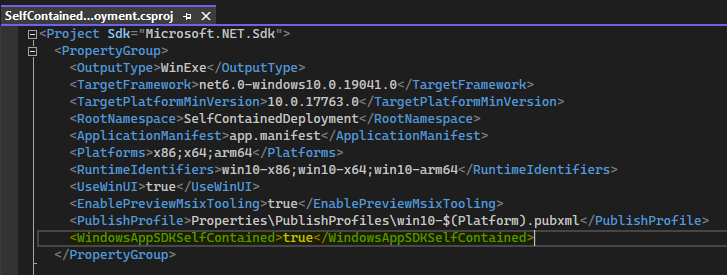

# Windows App SDK deployment guide for self-contained apps

A Windows App SDK project is framework-dependent by default. To switch to self-contained deployment, follow the steps below (the terms *framework-dependent* and *self-contained* are described in [Windows App SDK deployment overview](../deploy-overview.md)).

* In Visual Studio, right-click the app project node, and click **Edit Project File** to open the app project file for editing. For a C++ project, first click **Unload Project**.
* In the app project file, inside the main `PropertyGroup`, add `<WindowsAppSDKSelfContained>true</WindowsAppSDKSelfContained>` as shown in the screenshot below.

* Save and close the project file.
* Click **Reload Project**.
* If you're using a **Windows Application Packaging Project** (rather than the single-project MSIX that you get with **WinUI Blank App (Packaged)**), then make all of the above changes in the project file for the packaging project as well.

> [!NOTE]
> Library projects should not be changed. Self-contained deployment should only be configured in app projects (and, where applicable, in a **Windows Application Packaging Project**).

For sample apps, see [Windows App SDK self-contained deployment samples](https://github.com/microsoft/WindowsAppSDK-Samples/tree/main/Samples/SelfContainedDeployment).

Having set the `WindowsAppSDKSelfContained` property to `true` in your project file, the contents of the Windows App SDK Framework package will be extracted to your build output, and deployed as part of your application.

For packaged, packaged-with-external-location, and unpackaged apps, these app-local Framework binaries don't require a Framework MSIX dependency or Bootstrapper initialization. Other initialization, such as registration-free WinRT activation, and API-specific requirements still apply.

> [!NOTE]
> .NET apps need to be [published as self-contained](/dotnet/core/deploying/#publish-self-contained) as well to be fully self-contained. See [this sample](https://github.com/microsoft/WindowsAppSDK-Samples/blob/f1a30c2524c785739fee842d02a1ea15c1362f8f/Samples/SelfContainedDeployment/cs-winui-unpackaged/SelfContainedDeployment.csproj#L12) for how to configure .NET self-contained with publish profiles.
>
> Note that `dotnet publish` bundles managed assemblies but **cannot produce a single-file EXE** for WinUI 3 apps — the native Windows App SDK runtime dependencies must remain as separate files. See [Single-file EXE](../unpackage-winui-app.md#single-file-exe) for details.

> [!NOTE]
> C++ apps need to use the [hybrid CRT](https://github.com/microsoft/WindowsAppSDK/blob/main/docs/Coding-Guidelines/HybridCRT.md#what-is-the-hybrid-crt) as well to be fully self-contained. Importing [HybridCRT.props](https://github.com/microsoft/WindowsAppSDK/blob/main/HybridCRT.props) from [Directory.Build.props](/visualstudio/msbuild/customize-your-build#directorybuildprops-and-directorybuildtargets) is the recommended way to configure it for all projects in a solution (see an example in [Directory.Build.props](https://github.com/microsoft/WindowsAppSDK-Samples/blob/43404afcc4e72294b3e2706d2eff12418dbb815a/Samples/SelfContainedDeployment/cpp-winui-unpackaged/Directory.Build.props#L3)). A packaged app must also set `<UseCrtSDKReferenceStaticWarning>false</UseCrtSDKReferenceStaticWarning>` in their project file. See the [Self-contained deployment](https://github.com/microsoft/WindowsAppSDK-Samples/tree/main/Samples/SelfContainedDeployment/) sample app for how to use the hybrid CRT.

If your app is packaged (for more info, see [Package and deploy overview](../index.yml)), then the Windows App SDK dependencies will be included as content inside the MSIX package. Deploying the app still requires registering the MSIX package like any other packaged app.

If your app is packaged with external location or unpackaged, then the Windows App SDK dependencies are copied next to the `.exe` in your build output. You can xcopy-deploy the resulting files, or include them in a custom installer.

## Dependencies on additional MSIX packages

A small number of Windows App SDK features rely on additional MSIX packages or operating system (OS) functionality. These requirements are separate from the Framework package dependency and aren't supplied by copying Framework binaries app-locally.

* Push notification scenarios that use the *Singleton* package require that package to be deployed separately. Use [PushNotificationManager.IsSupported](/windows/windows-app-sdk/api/winrt/microsoft.windows.pushnotifications.pushnotificationmanager.issupported) to check support for the calling app. For example, an unpackaged self-contained app isn't supported by that API; installing Singleton alone doesn't remove that restriction.
* App notifications ([AppNotificationManager](/windows/windows-app-sdk/api/winrt/microsoft.windows.appnotifications.appnotificationmanager)) don't require Singleton and can be used with self-contained deployment, subject to the API's requirements. Use [AppNotificationManager.IsSupported](/windows/windows-app-sdk/api/winrt/microsoft.windows.appnotifications.appnotificationmanager.issupported) to check support.
* App Lifecycle supports self-contained deployment. Individual APIs still have packaging and OS restrictions. For example, packaged apps declare activation registrations in their package manifest, rather than calling the registration methods of [ActivationRegistrationManager](/windows/windows-app-sdk/api/winrt/microsoft.windows.applifecycle.activationregistrationmanager).

For features that require additional packages, you have the following options:

1. Make the functionality optional. Where available, call the API's **IsSupported** method to check whether the calling app and system support the feature.
    * This enables safe, conditional, optional use of the APIs without compromising the simplicity of your self-contained deployment.
    * Availability can depend on packaging and OS support as well as installed packages.
2. Deploy the required MSIX packages as part of your app installation.
    * Do this only for supported configurations. Installing a package doesn't override API-specific restrictions on self-contained deployment.
3. Don't use the API.
    * Consider alternative APIs that provide similar functionality without additional deployment requirements.

## Opting out of (or into) automatic UndockedRegFreeWinRT support

The project property **WindowsAppSdkUndockedRegFreeWinRTInitialize** controls whether the Windows App SDK's implementation of undocked registration-free Windows Runtime (*UndockedRegFreeWinRT*) is enabled automatically at app startup. That support is needed by unpackaged self-contained apps.

**WindowsAppSdkUndockedRegFreeWinRTInitialize** defaults to *true* if **WindowsAppSDKSelfContained** is *true* and **WindowsPackageType** is *None* and **OutputType** project property is set to *Exe* or *WinExe* (that is, the project produces an executable). That last condition prevents adding automatic UndockedRegFreeWinRT support into class library DLLs and other non-executables by default. If you *do* need automatic UndockedRegFreeWinRT support in a non-executable (for example, a test DLL loaded by a host process executable that doesn't initialize UndockedRegFreeWinRT), then you can explicitly enable it in your project with `<WindowsAppSdkUndockedRegFreeWinRTInitialize>true</WindowsAppSdkUndockedRegFreeWinRTInitialize>`.

## Related topics

* [Windows App SDK deployment overview](../deploy-overview.md)
* [Windows App SDK self-contained deployment samples](https://github.com/microsoft/WindowsAppSDK-Samples/tree/main/Samples/SelfContainedDeployment)
* [Package and deploy overview](../index.yml)
* [Deployment architecture for the Windows App SDK](../../windows-app-sdk/deployment-architecture.md)
