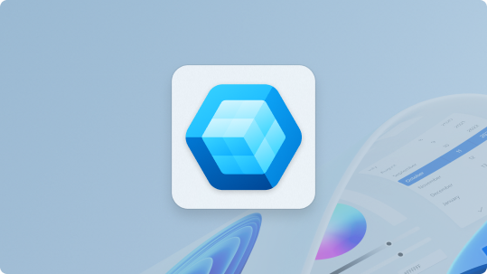
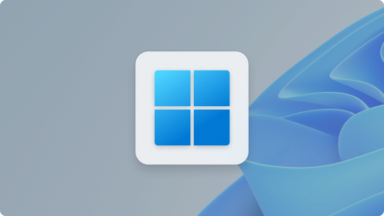

# What's new for Windows developers

This section curates the latest platform capabilities, SDK and API additions, AI integration options, performance and diagnostics improvements, design guidance updates, and productivity tooling enhancements. Microsoft refreshes these highlights as new capabilities ship.

---

## Latest SDK and WinUI releases

Find the latest downloads, release notes, and updates for the Windows SDK, Windows App SDK, and WinUI 3.

Versions below are current as of October 27, 2026. Use the release notes to review the changes and requirements for each channel or SDK build.

:::row:::
    :::column:::
         
        **Windows App SDK** 
        Latest stable: 2.6.4 
        Latest experimental: 2.5.4-experimental 
        [Stable release notes](../windows-app-sdk/release-notes/windows-app-sdk-2-0.md?pivots=stable#version-264) 
        [Experimental release notes](../windows-app-sdk/release-notes/windows-app-sdk-2-0.md?pivots=experimental#version-25-experimental-254-experimental) 
        [View downloads](../windows-app-sdk/downloads.md)
    :::column-end:::
    :::column:::
         
        **Windows SDK** 
        Latest 28000-series build: 10.0.28000.2957 
        Latest 26100-series build: 10.0.26100.9457 
        [View release notes](../windows-sdk/release-notes.md) 
        [View downloads](../windows-sdk/downloads.md)
    :::column-end:::
:::row-end:::

---

## Highlights – October 2026

### SDK releases and developer blog posts

- **Windows App SDK 2.6.4**: The October 27 stable release removes the Limited Access Feature unlock requirement for the Language Model APIs, updates ONNX Runtime to 1.27.1, and includes reliability and diagnostics fixes across WinUI 3, app lifecycle, notifications, composition, and Windows AI. Apps using earlier Windows App SDK versions must continue to follow the Language Model LAF requirements for their target Windows versions. See the [Windows App SDK 2.6.4 release notes](../windows-app-sdk/release-notes/windows-app-sdk-2-0.md?pivots=stable#version-264).
- **Microsoft.UI.Reactor (experimental)**: The October 21 post introduces a C#-first Model-View-Update framework that renders WinUI controls without XAML. Reactor is experimental, has no support policy or API guarantees, and isn't a replacement for XAML or MVVM. See [Microsoft.UI.Reactor: a C#-first way to build WinUI apps](https://devblogs.microsoft.com/ifdef-windows/microsoft-ui-reactor-a-c-first-way-to-build-winui-apps/).
- **PowerToys 0.102**: The October 21 release adds Mouse Button Lock and CursorHide, a Command Palette quick-access shelf, ZoomIt snip dictation, and command-line automation for more utilities. Color Picker and Text Extractor also move to WinUI 3. See [PowerToys 0.102 is here](https://devblogs.microsoft.com/commandline/powertoys-0-102-is-here-new-mouse-utilities-command-palette-improvements-and-much-more/).
- **Inside MSIX: external location and activation**: Learn how a package with external location supplements an existing installer, and how activatable extension points start packaged processes with package identity. See [External Location](https://devblogs.microsoft.com/insidemsix/msix-external-location/) (October 27) and [Activatable Extension Points](https://devblogs.microsoft.com/insidemsix/activatable-extension-points/) (October 20).
- **Microsoft Execution Containers is generally available**: The October 7 post describes policy-driven containment for AI agents, where developers and IT administrators define the files and network destinations an agent can use, and Windows enforces those policies at runtime. See [Microsoft Execution Containers: Policy-driven containment for AI agents](https://blogs.windows.com/windowsdeveloper/2026/10/07/microsoft-execution-containers-policy-driven-containment-for-ai-agents/).
- **WinUI Gallery 3.0**: The October 13 release is built on the experimental Windows App SDK (currently 2.5.4-experimental) and adds samples for the experimental TableView control and other upcoming WinUI controls and APIs. See [WinUI Gallery 3.0 is here](https://devblogs.microsoft.com/ifdef-windows/winui-gallery-3-0-is-here-tableview-charts-inkcanvas-and-more/).
- **.NET 11 Release Candidate 2**: The October 13 prerelease includes improvements across libraries, runtime, SDK, MSBuild, NuGet, ASP.NET Core, .NET MAUI, and Windows Forms. See [Announcing .NET 11 Release Candidate 2](https://devblogs.microsoft.com/dotnet/dotnet-11-rc-2/).
- **Inside MSIX: find package identity with existing tools**: Learn how to use `TASKLIST.EXE /APPS` and PowerShell to find a packaged process's package and application identity. See [Is it MSIX? Part 3](https://devblogs.microsoft.com/insidemsix/find-msix-package-application-identity/).
- **Windows App Development CLI 0.7.1**: The October 1 release is a maintenance update that hides MSBuild property JSON from `winapp run --aot` output. See the [v0.7.1 release notes](https://github.com/microsoft/winappCli/releases/tag/v0.7.1).
- **WSL 3.0.3**: A new release is available on GitHub. See the [WSL 3.0.3 release notes](https://github.com/microsoft/WSL/releases/tag/3.0.3).
- **Windows SDK September builds**: Builds 10.0.28000.2957 and 10.0.26100.9457 add the `Windows.ApplicationModel.Overlay` namespace. See the [Windows SDK release notes](../windows-sdk/release-notes.md).
- **Building Windows for hybrid intelligence**: The October 7 Windows Experience Blog post covers the platform direction for agents that operate both locally and in the cloud. See [Building Windows for hybrid intelligence](https://blogs.windows.com/windowsexperience/2026/10/07/building-windows-for-hybrid-intelligence/).

### Documentation highlights

- **Windows widget design and development**: Refreshed guidance helps you choose between packaged desktop providers and PWA widgets, build Adaptive Card templates, and validate sizes, themes, authentication states, and actions in the Widgets Board. Web widgets remain available only to users in the European Economic Area (EEA). Start with [Develop Windows Widgets](../develop/widgets/index.md) and the [widget design overview](../design/widgets/index.md).
- **Create a widget with GitHub Copilot**: A new guide provides a reusable, copy-and-paste prompt to select a supported architecture, generate provider code and package registration, and build and validate the widget. The prompt is included in the article, not distributed as a separately installable skill. See [Create a Windows widget with GitHub Copilot](../develop/widgets/create-widget-with-copilot.md).
- **Experimental WinUI controls**: New guidance covers [TableView](../develop/ui/controls/table-view.md), [PagerControl](../develop/ui/controls/pager-control.md), [WrapPanel](../develop/ui/layout-panels.md#wrappanel), and [InkCanvas and InkToolbar](../develop/ui/controls/ink-controls.md). These APIs require an experimental Windows App SDK package, might change or be removed, and aren't intended for production apps.
- **Microsoft Execution Containers SDK guides**: New conceptual articles cover .NET, TypeScript, and Rust SDK integration, resource policies, containment backends, and Learning Mode for Windows ProcessContainer workloads. Start with the [MXC overview](../develop/mxc/index.md) and [SDK quickstart](../develop/mxc/quickstart.md); available controls depend on the backend and host.
- **Windows People integration**: A task-based overview links to guides for contributing contacts, ranking Windows Share suggestions, enabling communication actions, and recording contact activities. Review the activity guide's availability caveats before depending on those APIs. See [Windows People](../develop/windows-integration/cross-device-people-api.md).
- **Focus session detection**: Updated WinUI 3 examples check API availability, distinguish focus sessions from Do not disturb, marshal UI updates, and unsubscribe from state-change events. `FocusSessionManager` is a Windows Runtime API, not a Windows App SDK API. See [Detect and react to focus session state](../windows-app-sdk/applifecycle/focus-session.md).

---

## Highlights – September 2026

### SDK releases and developer blog posts

- **Windows App SDK 2.5 Experimental (2.5.4-experimental)**: The September 29 experimental release adds AI compute-device selection, updated speech-recognition and language-model APIs, programmatic theme-resource binding, delegate-based `DataTemplate` construction, experimental `TableView` and Chart controls, and updated inking APIs. See the [Windows App SDK 2.5 experimental release notes](../windows-app-sdk/release-notes/windows-app-sdk-2-0.md?pivots=experimental#version-25-experimental-254-experimental).
- **WSL Containers is generally available**: Build, run, and deploy Linux containers on Windows by using the `wslc.exe` CLI, its `container.exe` alias, or the WSL Containers API. The GA release adds container lifecycle, networking, health-check, storage, Microsoft Defender for Endpoint, and Microsoft Intune capabilities. See [WSL Containers now generally available](https://blogs.windows.com/windowsdeveloper/2026/09/29/wsl-containers-now-generally-available/) and the [WSL Containers architecture deep dive](https://devblogs.microsoft.com/commandline/wslc-architecture-deep-dive/).
- **Visual Studio September update**: The update introduces Bring Your Own Model in preview, Copilot assistance for NuGet vulnerability fixes, pull-request exploration in the Git agent, improved branch-condition debugging, and Podman support for Attach to Process. See [Visual Studio September Update: Power Your Workflow with Your Model](https://devblogs.microsoft.com/visualstudio/visual-studio-september-update-power-your-workflow-with-your-model/).
- **Inside MSIX: identify packaged processes**: Learn how to use Task Manager's **Package name** column to distinguish packaged processes from unpackaged processes. See [How to tell if a process is packaged](https://devblogs.microsoft.com/insidemsix/how-to-tell-if-a-process-is-packaged/).
- **Windows App Development CLI 0.7.0**: The release adds Windows Sandbox execution, Native AOT support, one-step project packaging, single-file apps with package identity, the `winapp find-api` command, Reactor templates, and improved UI automation. See [WinAppCLI v0.7.0 release announcement](https://devblogs.microsoft.com/ifdef-windows/winappcli-v0-7-0-release-announcement/).
- **Windows App SDK 2.5.1**: The September 16 stable release adds support for the `windows.diagnosticServiceModule` package-manifest extension, limited-access App Content Search APIs for lexical and semantic search scenarios, and reliability fixes across WinUI, input, and composition. See the [Windows App SDK 2.5.1 release notes](../windows-app-sdk/release-notes/windows-app-sdk-2-0.md?pivots=stable#version-251).
- **.NET 11 performance improvements**: Review runtime, JIT, garbage collection, Native AOT, libraries, and SDK changes that improve application performance in .NET 11. See [Performance improvements in .NET 11](https://devblogs.microsoft.com/dotnet/performance-improvements-in-net-11/).
- **Intelligent Terminal 0.2.2572**: The update includes more than 60 performance and reliability fixes, faster startup and context gathering, API keys for local models, optional automatic approval, and native agent slash commands. See [Intelligent Terminal 0.2.2572: Performance & Reliability](https://devblogs.microsoft.com/commandline/intelligent-terminal-0-2-25-performance-reliability/).
- **.NET 11 Release Candidate 1**: The September 8 prerelease includes SDK tooling, C# 15, and Windows Forms updates, and comes with a go-live support license. Review the release notes and tool requirements before upgrading. See [Announcing .NET 11 Release Candidate 1](https://devblogs.microsoft.com/dotnet/dotnet-11-rc-1/).
- **September .NET servicing updates**: Security and non-security updates are available for .NET 10, .NET 9, .NET 8, and .NET Framework. See [.NET and .NET Framework September 2026 servicing updates](https://devblogs.microsoft.com/dotnet/dotnet-and-dotnet-framework-september-2026-servicing-updates/).
- **Project Zenith**: The September 4 announcement describes a developer-focused Windows experience with preinstalled tools and development settings on new developer-class devices. Initial availability is planned for AMD's Ryzen AI Halo. See [Announcing Project Zenith](https://blogs.windows.com/windowsdeveloper/2026/09/04/announcing-project-zenith-the-ready-to-code-windows-experience/).
- **Inside MSIX: servicing packages that are in use**: Learn why deployment can return `ERROR_PACKAGES_IN_USE`, and how application shutdown and deferred updates affect servicing. See [Servicing While In Use and ERROR_PACKAGES_IN_USE](https://devblogs.microsoft.com/insidemsix/msix-servicing-while-in-use/).
- **Inside MSIX: package storage**: Learn how `PackageVolume` manages staged packages, default and offline volumes, and storage on non-system volumes. See [MSIX PackageVolume: How Package Storage Works](https://devblogs.microsoft.com/insidemsix/msix-packagevolume/).

### Documentation highlights

- **WinUI 3 line-of-business apps**: A new hub brings together guidance on tabular data, validated forms, database access, design, migration, and AI for business applications. See [Build line-of-business apps with WinUI](../get-started/line-of-business/index.md).
- **AI-assisted WinUI development**: Build a task-tracking app while learning to inspect generated projects, check APIs against Microsoft Learn, and test the resulting UI and data behavior. See [Build a WinUI 3 task app with an AI assistant](../tutorials/winui-ai-assisted/intro.md).
- **AI-assisted modernization planning**: Use an updated, tool-neutral prompt that asks an assistant to inspect an existing desktop app, clarify constraints, and propose an incremental plan grounded in documentation. See [Plan your modernization with an AI assistant](../windows-app-sdk/migrate-to-windows-app-sdk/modernize-with-ai-assistant.md).
- **WinUI XAML Islands**: Updated hosting guidance explains how to add Windows App SDK controls to an existing desktop app and distinguishes WinUI XAML Islands from legacy UWP system XAML Islands. See [Host WinUI controls with XAML Islands](../desktop/modernize/host-controls-existing-desktop-apps.md).
- **WinUI 3 performance workflow**: The performance overview now connects measurement, startup optimization, responsiveness and rendering, and remeasurement, with links to focused guidance for each bottleneck. See [Improve your WinUI 3 app's performance](../develop/performance/index.md#improve-your-winui-3-apps-performance).

---

## Highlights – August 2026

- **Windows App SDK 2.4 Experimental (2.4.1-experimental)**: The August 25 experimental release adds **inking support for WinUI 3** — the new `InkCanvas`, `InkToolbar`, and `InkPresenter` APIs bring pen and touch input, stroke input, unprocessed input, and clipboard and high-contrast support to WinUI 3 apps. It rolls the 2.4.0 stable changes forward on the experimental channel — [Release notes](https://github.com/microsoft/WindowsAppSDK/releases/tag/v2.4.1-exp) | Install: `Microsoft.WindowsAppSDK` version `2.4.1-experimental` from NuGet
- **Windows SDK build 10.0.28000.2705**: The latest Windows SDK flight (August 2026) adds new WinRT and Win32 APIs, including `Windows.Management.Update` scan-mode and software-update identity/category types, `RetailInfo.IsDemoModeEnabledEx`, `ToastNotification.IsExpandableContentSupported`, a Direct3D 12 `ID3D12DeviceStatistics` interface, an AV1 encoder operating-mode codec API, and endorsement-key enrollment v2 cryptography OIDs — [Windows SDK release notes](../windows-sdk/release-notes.md) | [Downloads](../windows-sdk/downloads.md)
- **Inside MSIX – What Kind of Packaged Process Is It?**: Howard Kapustein breaks down the three kinds of packaged process — Universal, Centennial/Desktop Bridge, and Win32alacarte — and how the `RuntimeBehavior` manifest attribute (`windowsApp`, `packagedClassicApp`, `win32App`) trades off compatibility against modern packaged behavior — [What Kind of Packaged Process Is It?](https://devblogs.microsoft.com/insidemsix/types-of-packaged-applications/)
- **PowerToys 0.101**: Adds **Window Hopper** for quickly moving between windows from the same app, a redesigned update experience with **Stable and Insider channels**, **compact mode** for Command Palette, on-device Phi Silica transformations in Advanced Paste, and continued WinUI 3 modernization — [PowerToys 0.101 release](https://devblogs.microsoft.com/commandline/powertoys-0-101-is-here-window-hopper-insider-updates-and-command-palette-compact-mode/)
- **AppxManifest IntelliSense in the WinApp VS Code extension**: The WinApp VS Code extension now provides IntelliSense — completions, tooltips, and validation — for `AppxManifest.xml`, making it easier to author package identity and capabilities without leaving the editor — [Announcing AppxManifest IntelliSense support](https://devblogs.microsoft.com/ifdef-windows/appxmanifest-intellisense-support-in-vs-code/)
- **Windows App SDK 2.4.0**: The August 13 stable release adds touchpad and mouse haptics for WinUI 3 apps (via `Windows.Devices.Haptics`), touchpad single-finger panning on supported hardware, and more precise `LanguageModel` response statuses — `UnsupportedLanguage` and `LanguageMismatch` — so apps can distinguish language errors from generic failures. Also includes targeted reliability fixes for input, Storage Pickers (keyboard focus now restores after a dialog closes), MRT Core, app runtime isolation, and composition — [Release notes](https://github.com/microsoft/WindowsAppSDK/releases/tag/v2.4.0)
- **Windows App Development CLI v0.6.0**: Adds `winapp new` to scaffold a WinUI 3 app from official templates with a single command (blank, NavigationView, TabView, MVVM, class library, and unit-test starters), `winapp find-ui` to search and fetch copy-pasteable XAML and C# samples from WinUI 3 Gallery and Windows Community Toolkit without leaving the terminal, run-from-`.csproj` with no manual build step, cloud-based artifact signing via Azure, and sparse-package workflow support — [WinApp CLI v0.6.0 announcement](https://devblogs.microsoft.com/ifdef-windows/windows-app-development-cli-v0-6-create-new-winui-applications-sign-packages-with-azure-and-more/) | Install: `winget install Microsoft.WinAppCli`
- **Intelligent Terminal 0.2**: The biggest release yet of the experimental AI-powered terminal, adding local model support in the Agent Pane, per-tab agent selection with `/agent`, OpenCode in the built-in agent lineup, WSL agent execution, and a richer Agent Pane UI — [Intelligent Terminal 0.2 announcement](https://devblogs.microsoft.com/commandline/intelligent-terminal-0-2-is-here-with-local-model-support/) | Install: `winget install Microsoft.IntelligentTerminal`
- **Inside MSIX – Package Lifetime**: How MSIX uses a garbage-collection design for staged package lifetime — why destaging is not a direct result of a single API call, what holds a reference, and when payloads are automatically removed from disk — [MSIX Package Lifetime](https://devblogs.microsoft.com/insidemsix/msix-package-lifetime/)
- **The Old New Thing**: Raymond Chen's long-running blog on practical Windows development — internals, Win32, shell behavior, and the history behind platform decisions — [The Old New Thing](https://devblogs.microsoft.com/oldnewthing/)

