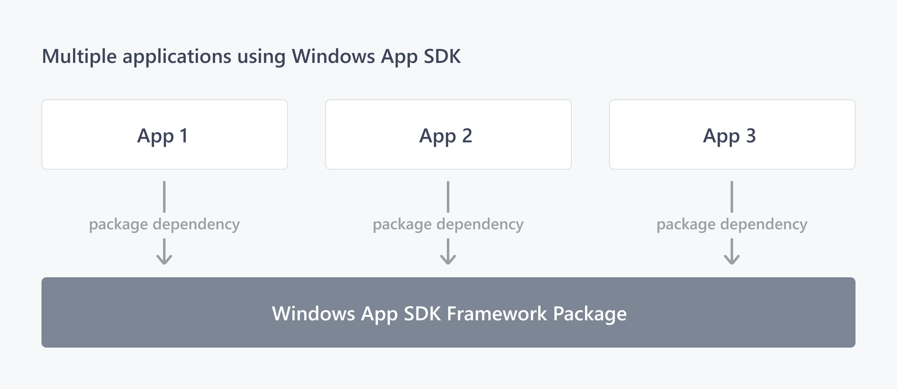
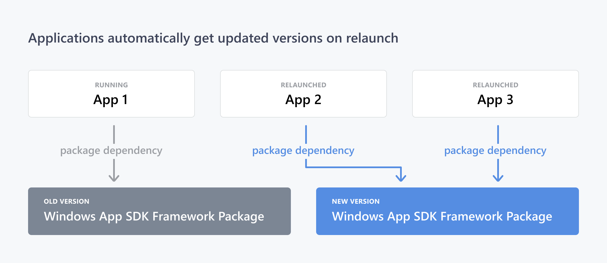

# Deployment architecture and overview for framework-dependent apps

This article explains a high-level architecture of Windows App SDK deployment. The concepts below apply primarily to Windows App SDK framework-dependent apps. A framework-dependent app depends on the Windows App SDK runtime being present on the target machine. 

Framework-dependent apps require the Windows App SDK Framework package in their process package graph. How you establish that dependency is separate from how you install the runtime:

| App&nbsp;deployment method  | Requirements |
|------------------------|---------|
| Packaged | Declare the Framework dependency statically in the package manifest. Use the Deployment API when needed to deploy additional Main and Singleton packages. |
| Packaged with external location (sparse package) | Declare the Framework dependency statically with `<PackageDependency>` in `AppxManifest.xml`. Ensure the required runtime packages are installed, for example by using the runtime installer or installing the MSIX packages directly. Bootstrapper initialization isn't required for the static Framework dependency. |
| Unpackaged | Install the required runtime packages using the installer or by installing the MSIX packages directly. Establish the Framework dependency dynamically with the Bootstrapper API, either through auto-initialization or explicit calls. |

Self-contained deployment is an alternative for all three packaging options. Self-contained apps carry the Framework binaries app-locally and don't need a Framework MSIX dependency or Bootstrapper initialization for those binaries. Additional feature dependencies are separate; see [Windows App SDK deployment guide for self-contained apps](../package-and-deploy/self-contained-deploy/deploy-self-contained-apps.md).

For more details on these requirements, see the following articles:
- [Windows App SDK deployment guide for framework-dependent packaged apps](deploy-packaged-apps.md) 
- [Windows App SDK deployment guide for framework-dependent unpackaged apps](deploy-unpackaged-apps.md)

## Key terms

The following sections define key terms for Windows App SDK deployment and additional details on some of these packages.

| Term | Definition |
|------|------------|
| **Windows App SDK runtime** | The MSIX packages required by an app to use the Windows App SDK. These packages include: Framework, Main, Singleton, and DDLM. Depending on the features used and your app deployment method, you will need a certain set of these packages on the target machine. |
| **Framework package** | Contains binaries used at runtime by framework-dependent apps (most Windows App SDK features). Apps reference it statically through their package manifest or dynamically through Bootstrapper initialization. The app-local Bootstrapper library is distributed separately from the Framework package. |
| **Main package** | Package that contains background tasks to keep track of dynamic dependencies, and enables automatic updates to the Framework package from the Microsoft Store. |
| **Singleton package** | Contains background tasks, services, app extensions, and other components not included in the Framework package such as Push Notifications. This is generally a single long-running process that is brokered between apps. |
| **Dynamic Dependency Lifetime Manager (DDLM) package** | Keeps the dynamically referenced Framework package in use while an unpackaged app runs, on systems where the Bootstrapper uses DDLM rather than OS-native dynamic dependency lifetime management. |
| **Bootstrapper** | An app-local library used to locate a compatible installed Windows App SDK Framework package and add it dynamically to an unpackaged process's package graph. It isn't needed for a static manifest dependency or app-local self-contained Framework binaries. |
| **Provisioning** | The process of staging packages system-wide so that any user on the machine can register and use them without requiring per-machine staging to be repeated. Provisioning can be performed as part of the OS image or during enterprise app deployment. |
| **Installer** | Refers to the .exe installer which deploys the Framework, Main, Singleton, and DDLM packages. |
| **MSIX** | Modern installer technology that enables users to safely install an app per user, directly from the Microsoft Store or a web site. On Enterprise or shared PCs, apps can be installed for all users via PowerShell and MDM. |

### Framework package

When you build an app that uses the Windows App SDK, your app references a set of Windows App SDK runtime components that are distributed to end users via a *framework package*. The framework package allows apps to access Windows App SDK components through a single shared source on the user's device, instead of bundling them into the app package. The framework package also carries its own resources, such as DLLs and API definitions (COM and Windows Runtime registrations). These resources run in the context of your app, so they inherit the capabilities and privileges of your app, and don't assert any capabilities or privileges of their own. For more information about framework package dependencies, see [MSIX framework packages and dynamic dependencies](../desktop/modernize/framework-packages/framework-packages-overview.md).

The Windows App SDK framework package is an MSIX package that is deployed to end users through the Microsoft Store. It can be easily and quickly updated with servicing releases, which may include security and reliability fixes. All framework-dependent apps that use the Windows App SDK have a dependency on a shared instance of the framework package, as illustrated in the following diagram.

When a new version of the Windows App SDK framework package is serviced, all framework-dependent apps are updated to the new version without themselves having to redistribute a copy. Windows updates to the newest version of frameworks as they are released, and apps will automatically reference the latest framework package version during relaunch. Older framework package versions will not be removed from the system until they are no longer running or being actively used by apps on the system.

Because app compatibility is important to Microsoft and to apps that depend on the Windows App SDK, the Windows App SDK framework package follows [Semantic Versioning 2.0.0](https://semver.org/) rules. This means that after we release version 1.0 of the Windows App SDK, the Windows App SDK framework package will guarantee compatibility between minor and patch version changes, and breaking changes will occur only between major version updates.

### Singleton package

The **singleton package** ensures that a single long-running process can handle services that are used across multiple apps, which may be running on different versions of the Windows App SDK. 

The Windows App SDK singleton is needed to enable [push notifications](../develop/notifications/push-notifications/index.md) for unpackaged apps and packaged Win32 applications using Windows versions below 20H1, which cannot be supported by the existing UWP [PushNotificationTrigger](/uwp/api/Windows.ApplicationModel.Background.PushNotificationTrigger) and [ToastNotificationActionTrigger](/uwp/api/windows.applicationmodel.background.toastnotificationactiontrigger) classes. Future Windows App SDK features that cannot be supported by the Framework package will be added to the Singleton package.

## Dynamic Framework dependencies for unpackaged apps

### Bootstrapper

An unpackaged framework-dependent app that uses the Bootstrapper must distribute the Bootstrapper library with the app. The library provides the Bootstrapper API (see [Initialize the Windows App SDK Framework package dynamically](use-windows-app-sdk-run-time.md)), which performs these tasks:

- Initialize the Dynamic Dependency Lifetime Manager (DDLM) where required by the operating system.
- Find and load the Windows App SDK framework package to the app's package graph.

For an unpackaged framework-dependent executable, setting `<WindowsPackageType>None</WindowsPackageType>` in the `.csproj` or `.vcxproj` file enables the Bootstrapper [auto-initializer](/windows/apps/package-and-deploy/project-properties#auto-initializers-in-the-windows-app-sdk) by default. If you need explicit control, disable the auto-initializer and call the Bootstrapper API in your startup code (see [Tutorial: Use the bootstrapper API in an unpackaged app](tutorial-unpackaged-deployment.md)). Establish the Framework dependency before using APIs from that package.

Packaged apps, including apps packaged with external location, can establish the same dependency statically through their package manifest. They don't need the Bootstrapper for that dependency. Self-contained apps don't need the Bootstrapper for their app-local Framework binaries either.

The bootstrapper library in the Windows App SDK 1.0 release includes:

- **Microsoft.WindowsAppRuntime.Bootstrap.dll** (C++ and C#) 
- **Microsoft.WindowsAppRuntime.Bootstrap.Net.dll** (C# wrapper)

### Dynamic Dependency Lifetime Manager (DDLM)

The DDLM keeps a dynamically referenced Windows App SDK Framework package in use by an unpackaged app. On systems where DDLM is required, the Bootstrapper initializes it early in the app's startup. On supported versions of Windows 11, the Bootstrapper can use OS-native dynamic dependency lifetime management instead. Static manifest dependencies don't require Bootstrapper or DDLM initialization.

There is one DDLM for each version and architecture of the Windows App SDK framework package. This means on an `x64` computer, you may have both an `x86` and an `x64` version of the DDLM to support apps of both architectures.

## Additional requirements

* For packaged apps, the VCLibs framework package dependency is a requirement. For more info, see [C++ Runtime framework packages for Desktop Bridge](/troubleshoot/cpp/c-runtime-packages-desktop-bridge).
* For unpackaged apps, the Visual C++ Redistributable is a requirement. For more info, see [Microsoft Visual C++ Redistributable latest supported downloads](/cpp/windows/latest-supported-vc-redist).
* **C#**. For the .NET runtime, see [Download .NET](https://dotnet.microsoft.com/download).

## MSIX deployment pipeline

When you add an MSIX package to a machine, the deployment engine processes the request through three stages:

| Stage | Scope | What happens |
|---|---|---|
| **Index** | Per-machine | Parses the package manifest and records metadata and the intended installation path |
| **Stage** | Per-machine | Creates the package directory, extracts payload, and applies ACLs |
| **Register** | Per-user | Associates the staged package with a specific user — creates Start menu entries, file type associations, and runtime data |

Staging is performed once per machine; registration is per-user. This separation allows a package to be made available (or removed) for one user without affecting others.

> [!NOTE]
> The term *install* is informal — it isn't a formal concept in the MSIX deployment engine. Deployment requests use the `PackageManager` API to submit operations (Add, Stage, Register, Remove, and so on) to the deployment queue. See [There is no Install – it's 'Stage' and 'Register'](https://devblogs.microsoft.com/insidemsix/there-is-no-install-its-stage-and-register/) on the Inside MSIX blog for a full explanation.

## Related topics

* [Windows App SDK deployment guide for framework-dependent packaged apps](deploy-packaged-apps.md)
* [Windows App SDK deployment guide for framework-dependent unpackaged apps](deploy-unpackaged-apps.md)
* [Inside MSIX blog](https://devblogs.microsoft.com/insidemsix/) — deep dives on MSIX architecture, package identity, deployment operations, and more, by the MSIX engineering team
* [What is MSIX?](/windows/msix/overview)
* [Troubleshooting packaging, deployment, and query of Windows apps](/windows/win32/appxpkg/troubleshooting)
* [Release channels and release notes](release-channels.md)
