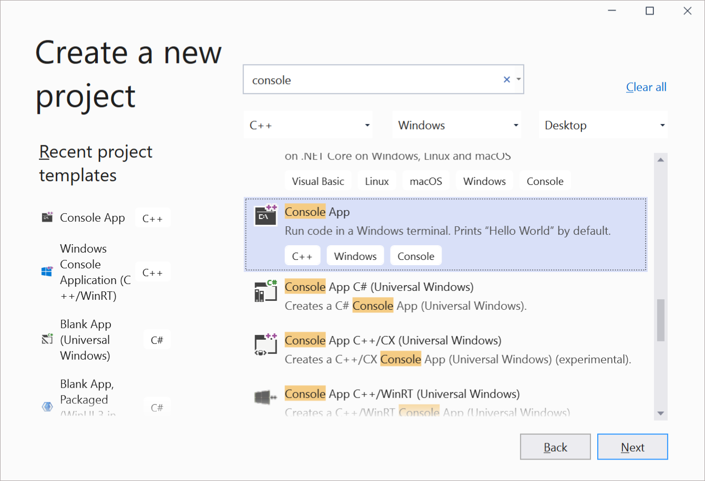
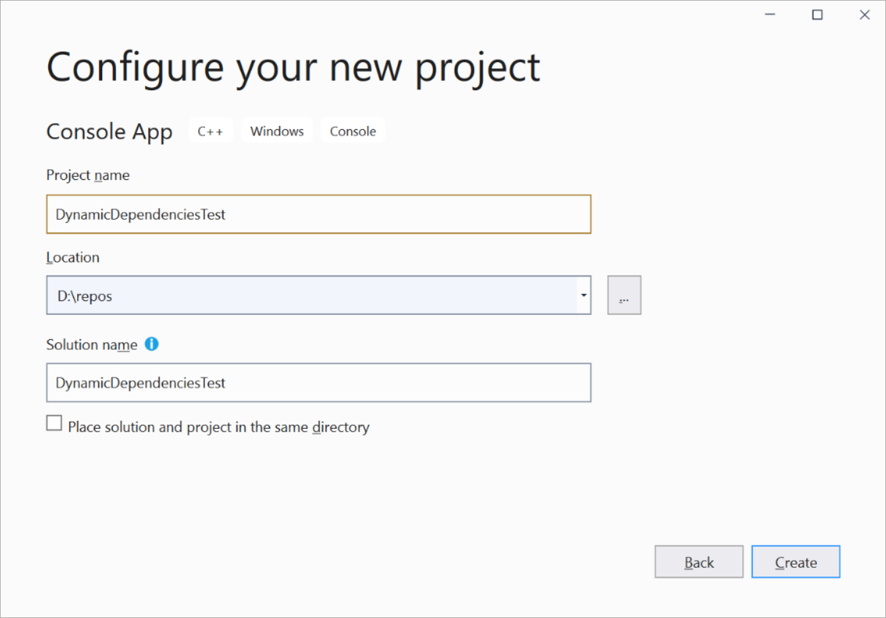

# Tutorial: Use the bootstrapper API in an unpackaged app

This article shows how to configure an unpackaged framework-dependent app to use the Bootstrapper API explicitly. The Bootstrapper adds an installed Windows App SDK Framework package to the process package graph before the app calls APIs from that package.

Packaged apps, including apps packaged with external location (sparse packages), can declare this dependency statically with `<PackageDependency>` in `AppxManifest.xml` instead. They don't need Bootstrapper initialization for that dependency. Self-contained apps carry the Framework binaries app-locally and don't need a Framework MSIX dependency or Bootstrapper initialization for those binaries.

> [!IMPORTANT]
> For an unpackaged framework-dependent executable, setting `<WindowsPackageType>None</WindowsPackageType>` enables Bootstrapper *auto-initialization* by default. For the steps involved in a WinUI 3 project, see [Distribute an unpackaged WinUI 3 app](../package-and-deploy/unpackage-winui-app.md). For an existing project that doesn't use WinUI, see [Use the Windows App SDK in an existing project](./use-windows-app-sdk-in-existing-project.md).
>
> If you have advanced needs (such as custom error handling, or to load a specific version of the Windows App SDK), then you can instead call the bootstrapper API explicitly. And that's the approach that this topic demonstrates. Also, for more info, see [Initialize the Windows App SDK Framework package dynamically](./use-windows-app-sdk-run-time.md).

This topic demonstrates explicitly calling the bootstrapper API from a basic Console app project; but the steps apply to any unpackaged desktop app that uses the Windows App SDK.

Before completing this tutorial, review [Runtime architecture](./deployment-architecture.md) to learn how static manifest dependencies, dynamic Bootstrapper dependencies, and self-contained deployment differ.

## Prerequisites

1. [Install tools for the Windows App SDK](../get-started/start-here.md#set-up-your-development-environment).
1. Install the dependencies for an unpackaged framework-dependent app (see [Windows App SDK deployment guide for framework-dependent unpackaged apps](./deploy-unpackaged-apps.md#prerequisites)). You can do this by running the Windows App SDK runtime installer.

## Instructions

You can follow this tutorial using a C# or a C++ project.

> [!NOTE]
> The dynamic dependencies and bootstrapper APIs fail when called by an elevated process. As a result, Visual Studio shouldn't be launched elevated. See [Dynamic Dependencies doesn't support elevation #567](https://github.com/microsoft/WindowsAppSDK/issues/567) for more details.

### [C#](#tab/csharp)

Follow these instructions to configure an unpackaged C# console project for explicit Bootstrapper initialization.

1. In Visual Studio, create a new C# **Console App** project. Name the project **DynamicDependenciesTest**. After you create the project, you should have a "Hello, World!" C# console app.

1. Next, configure your project.

    1. In **Solution Explorer**, right-click your project and choose **Edit Project File**.
    1. Replace the value of the **TargetFramework** element with a [Target Framework Moniker](../desktop/modernize/winrt-apis-desktop-apps.md#net-6-and-later-use-the-target-framework-moniker-option). For example, use the following if your app targets Windows 10, version 2004.

    ```xml
    <TargetFramework>net8.0-windows10.0.19041.0</TargetFramework>
    ```

    1. In the same `PropertyGroup` in the `.csproj` file, identify the project as unpackaged and disable automatic Bootstrapper initialization so that the sample controls initialization and shutdown.

    ```xml
    <WindowsPackageType>None</WindowsPackageType>
    <WindowsAppSdkBootstrapInitialize>false</WindowsAppSdkBootstrapInitialize>
    ```

    1. Save and close the project file.

1. Change the platform for your solution to **x64**. The default value in a .NET project is **AnyCPU**, but WinUI doesn't support that platform.

    1. Select **Build** > **Configuration Manager**.
    1. Select the drop-down under **Active solution platform** and click **New** to open the **New Solution Platform** dialog box.
    1. In the drop-down under **Type or select the new platform**, select **x64**.
    1. Click **OK** to close the **New Solution Platform** dialog box.
    1. In **Configuration Manager**, click **Close**.

1. Install the Windows App SDK NuGet package in your project.

    1. In **Solution Explorer**, right-click the **Dependencies** node and choose **Manage Nuget Packages**.
    1. In the **NuGet Package Manager** window, select the **Browse** tab, and install the **Microsoft.WindowsAppSDK** package.

1. You're now ready to use the bootstrapper API (see [Initialize the Windows App SDK Framework package dynamically](use-windows-app-sdk-run-time.md)) to dynamically take a dependency on the Windows App SDK framework package. This enables you to use the Windows App SDK APIs in your app.

    Open the **Program.cs** code file, and replace the default code with the following code to call the [**Bootstrap.Initialize**](../api-reference/cs-bootstrapper-apis/microsoft.windows.applicationmodel.dynamicdependency/microsoft.windows.applicationmodel.dynamicdependency.bootstrap.md#initialize-methods) method to initialize the bootstrapper. This code defines what version of the Windows App SDK the app is dependent upon when initializing the bootstrapper.

    > [!IMPORTANT]
    > You'll need to edit the code below to suit your specific configuration. See the descriptions of the parameters of the [**Bootstrap.Initialize**](../api-reference/cs-bootstrapper-apis/microsoft.windows.applicationmodel.dynamicdependency/microsoft.windows.applicationmodel.dynamicdependency.bootstrap.md#initialize-methods) method so that you can specify one of the versions of the Windows App SDK that you have installed.

    ```csharp
    using System;
    using Microsoft.Windows.ApplicationModel.DynamicDependency;
    
    namespace DynamicDependenciesTest
    {
        class Program
        {
            static void Main(string[] args)
            {
                Bootstrap.Initialize(0x00010005);
                Console.WriteLine("Hello, World!");
    
                // Release the DDLM and clean up.
                Bootstrap.Shutdown();
            }
        }
    }
    ```

    > [!NOTE]
    > The hexadecimal value passed to `Bootstrap.Initialize` encodes the major and minor version of the Windows App SDK runtime your app targets. `0x00010005` represents version 1.5. Update this value to match the Windows App SDK version your project references (for example, `0x00010006` for version 1.6).

    At its root, the bootstrapper API is a native C/C++ API that enables you to use the Windows App SDK APIs in your app. But in a .NET app that uses the Windows App SDK 1.0 or later, you can use the [.NET wrapper for the bootstrapper API](./use-windows-app-sdk-run-time.md#net-wrapper-for-the-bootstrapper-api). That wrapper provides an easier way of calling the bootstrapper API in a .NET app than calling the native C/C++ functions directly. The previous code example calls the static [**Initialize**](../api-reference/cs-bootstrapper-apis/microsoft.windows.applicationmodel.dynamicdependency/microsoft.windows.applicationmodel.dynamicdependency.bootstrap.md#initialize-methods) and **Shutdown** methods of the **Bootstrap** class in the .NET wrapper for the bootstrapper API.

1. To demonstrate that the Windows App SDK runtime components were loaded properly, add some code that uses the [ResourceManager](/windows/windows-app-sdk/api/winrt/microsoft.windows.applicationmodel.resources.resourcemanager) class in the Windows App SDK to load a string resource.

    1. Add a new **Resources File (.resw)** to your project (leave the default name).

    1. With the resources file open in the editor, create a new string resource with the following properties.
        - Name: **Message**
        - Value: **Hello, resources!**

    1. Save the resources file.

    1. Open the **Program.cs** code file, and replace the `Console.WriteLine("Hello, World!");` line with the following code.

    ```csharp
    // Create a resource manager using the resource index generated during build.
       var manager = new Microsoft.Windows.ApplicationModel.Resources.ResourceManager("DynamicDependenciesTest.pri");

    // Look up a string in the .resw file using its name.
    Console.WriteLine(manager.MainResourceMap.GetValue("Resources/Message").ValueAsString);
    ```

    1. Click **Start Without Debugging** (or **Start Debugging**) to build and run your app. You should see the string `Hello, resources!` successfully displayed.

### [C++](#tab/cpp)

Follow these instructions to configure an unpackaged C++ console project for explicit Bootstrapper initialization.

1. In Visual Studio, create a new C++ **Console App** project. Name the project **DynamicDependenciesTest**.
    

    

    After you create the project, you should have a "Hello, World!" C++ console app.

1. In the `.vcxproj` file, add the following properties to `<PropertyGroup Label="Globals">` so that the sample controls Bootstrapper initialization and shutdown.

    ```xml
    <WindowsPackageType>None</WindowsPackageType>
    <WindowsAppSdkBootstrapInitialize>false</WindowsAppSdkBootstrapInitialize>
    ```

1. Next, install the Windows App SDK NuGet package in your project. 

    1. In **Solution Explorer**, right-click the **References** node and choose **Manage Nuget Packages**. 
    1. In the **NuGet Package Manager** window, select the **Browse** tab, and search for **Microsoft.WindowsAppSDK**.

1. You're now ready to use the bootstrapper API (see [Initialize the Windows App SDK Framework package dynamically](./use-windows-app-sdk-run-time.md)) to initialize the Windows App SDK runtime in your app. This enables you to use the Windows App SDK APIs in the app.

    1. Add the following include files to the top of your **DynamicDependenciesTest.cpp** file. The [mddbootstrap.h](/windows/windows-app-sdk/api/win32/mddbootstrap) header is available via the Windows App SDK NuGet package.

    ```cpp
    #include <windows.h>
    #include <objbase.h>
    #include <MddBootstrap.h>
    #pragma comment(lib, "ole32.lib")
    ```

    1. Next, add this code at the beginning of your **main** method to initialize COM and call [**MddBootstrapInitialize2**](/windows/windows-app-sdk/api/win32/mddbootstrap/nf-mddbootstrap-mddbootstrapinitialize2). This code defines the Framework version criteria and handles initialization errors.

    > [!IMPORTANT]
    > You'll need to edit the code below to suit your specific configuration. See the descriptions of the parameters of [**MddBootstrapInitialize2**](/windows/windows-app-sdk/api/win32/mddbootstrap/nf-mddbootstrap-mddbootstrapinitialize2) so that you can specify a version of the Windows App SDK that you have installed.

    ```cpp
    const HRESULT comHr{ CoInitializeEx(nullptr, COINIT_MULTITHREADED) };
    if (FAILED(comHr))
    {
        return comHr;
    }

    const UINT32 majorMinorVersion{ 0x00010005 };
    PCWSTR versionTag{ L"" }; 
    const PACKAGE_VERSION minVersion{};

    const HRESULT hr{ MddBootstrapInitialize2(majorMinorVersion, versionTag, minVersion, MddBootstrapInitializeOptions_None) };

    // Check the return code for errors. If there is an error, display the result.
    if (FAILED(hr)) 
    { 
        wprintf(L"Error 0x%X in MddBootstrapInitialize2(0x%08X, %s, %hu.%hu.%hu.%hu)\n",
            hr, majorMinorVersion, versionTag, minVersion.Major, minVersion.Minor, minVersion.Build, minVersion.Revision); 
        CoUninitialize();
        return hr; 
    } 
    ```

    1. Finally, add this code to display the string `Hello, World!` and call the [**MddBootstrapShutdown**](/windows/windows-app-sdk/api/win32/mddbootstrap/nf-mddbootstrap-mddbootstrapshutdown) function to uninitialize the bootstrapper.

    ```cpp
    std::cout << "Hello, World!\n"; 
    
    // Release the DDLM and clean up.
    MddBootstrapShutdown(); 
    CoUninitialize();
    ```

    1. Your final code should look like this.

    ```cpp
    #include <iostream> 
    #include <windows.h> 
    #include <objbase.h>
    #include <MddBootstrap.h>
    #pragma comment(lib, "ole32.lib")
       
    int main() 
    { 
        const HRESULT comHr{ CoInitializeEx(nullptr, COINIT_MULTITHREADED) };
        if (FAILED(comHr))
        {
            return comHr;
        }

        // Take a dependency on Windows App SDK Stable.
        const UINT32 majorMinorVersion{ 0x00010005 }; 
        PCWSTR versionTag{ L"" }; 
        const PACKAGE_VERSION minVersion{};

        const HRESULT hr{ MddBootstrapInitialize2(majorMinorVersion, versionTag, minVersion, MddBootstrapInitializeOptions_None) };
        
        // Check the return code. If there is a failure, display the result.
        if (FAILED(hr)) 
        { 
            wprintf(L"Error 0x%X in MddBootstrapInitialize2(0x%08X, %s, %hu.%hu.%hu.%hu)\n",
                hr, majorMinorVersion, versionTag, minVersion.Major, minVersion.Minor, minVersion.Build, minVersion.Revision); 
            CoUninitialize();
            return hr; 
        } 
        
        std::cout << "Hello, World!\n"; 
      
        // Release the DDLM and clean up.
        MddBootstrapShutdown(); 
        CoUninitialize();
    } 
    ```

1. Click **Start Without Debugging** (or **Start Debugging**) to build and run your app.

---

## If your project is WPF

For a Windows Presentation Foundation (WPF) app, see [Use the Windows App SDK in an existing project](use-windows-app-sdk-in-existing-project.md?pivots=dotnet).

## Related topics

* [Windows App SDK deployment guide for framework-dependent unpackaged apps](./deploy-unpackaged-apps.md)
* [Runtime architecture](./deployment-architecture.md)
