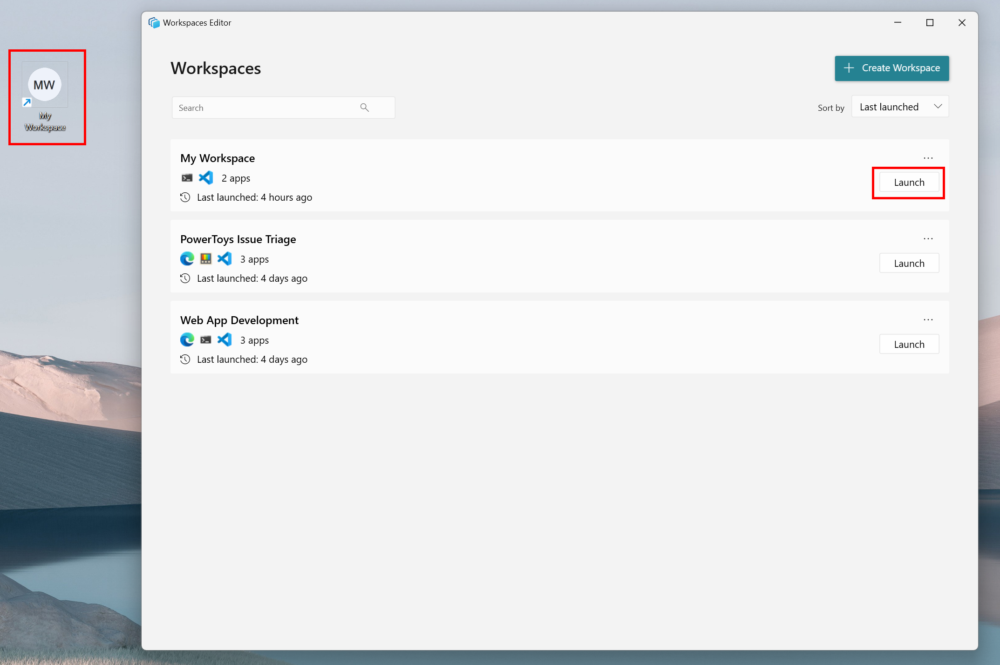
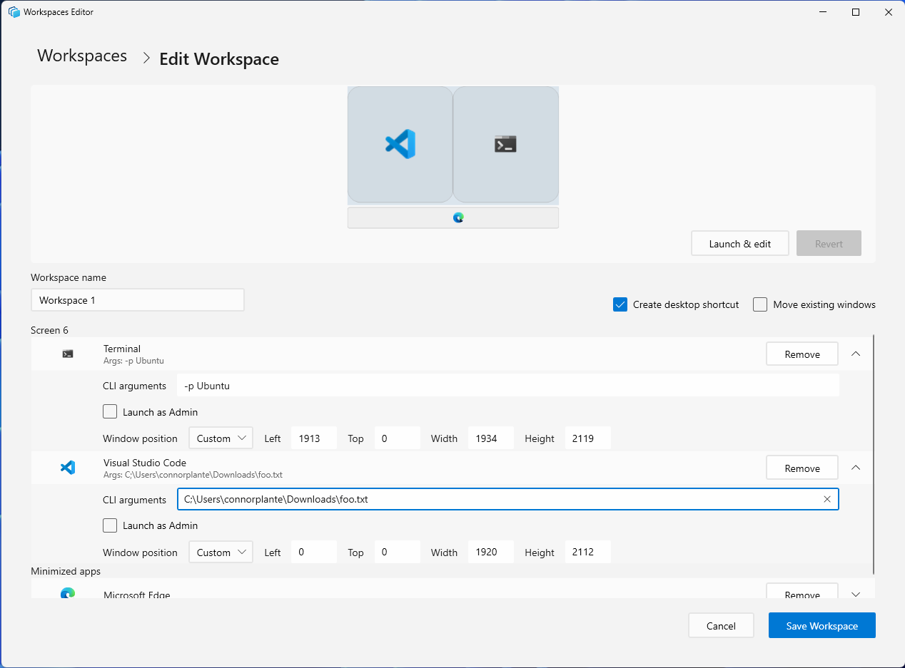

# Workspaces utility for Windows desktop management

PowerToys Workspaces is a desktop manager utility that helps you launch applications to custom positions and configurations with a single click. This Windows desktop management tool gets you into your ideal desktop state for any project or activity faster. You can capture your desktop state as a new workspace using the editor, add arguments to apps to configure their state on launch, and pin the workspace as a desktop shortcut for quick-launching.

## Enabling

To start using Workspaces, enable it in the PowerToys Settings.

## Creating a new workspace

Open the editor using by selecting "Launch editor" from PowerToys Workspaces settings or by using the shortcut <kbd>⊞ Win</kbd>+<kbd>Ctrl</kbd>+<kbd>`</kbd>.

:::image type="content" source="images/workspaces/workspaces_editor.png" alt-text="Screenshot of PowerToys Workspaces editor interface showing workspace creation options.":::

Click "+ Create workspace" to invoke the Capture experience - in this view, the desktop is fully functional and you are able to open, close, and reposition apps to get your apps into the desired layout. Once you have arranged the apps how you would like, select "Capture".

:::image type="content" source="images/workspaces/capture_ux.png" alt-text="Screenshot of PowerToys Workspaces capture experience showing app arrangement options.":::

After capturing, you will enter the editor where you can name the workspace, adjust window sizes, add command line interface (CLI) arguments, remove apps, and create a desktop shortcut before finally saving the workspace.

:::image type="content" source="images/workspaces/post_capture_edit.png" alt-text="Screenshot of PowerToys Workspaces editor interface after capturing showing workspace editing options.":::

## Launching a workspace

Launch a workspace by either selecting "Launch" from the list of workspaces in the editor, or by using a desktop shortcut if you chose to create one when saving the workspace originally. Shortcuts can also be pinned to the taskbar for convenient launching.



While the workspace launches, PowerToys will display a dialog box presenting the status of each app. Each app will have one of the following statuses:

| Symbol      | Status    |
|-------------|-----------|
|  | The app has successfully launched and repositioned. |
|  | The app is in the process of launching and moving to the correct position. |
|  | The app has failed to launch. |

The dialog box will dismiss itself once all apps have properly launched and been arranged in their desired positions. You can also dismiss the dialog yourself at any time, or use it to cancel the launch.

## Command-line interface (preview)

> [!IMPORTANT]
> The Workspaces CLI is available in PowerToys preview builds that include `PowerToys.Workspaces.CLI.exe`. Don't assume that your installed stable release includes it. For preview update options, see [PowerToys update channels](update-channel.md).

Use the CLI to list saved workspaces, inspect their configuration, or launch one. It doesn't capture, create, import, edit, or delete workspaces. To create or change a layout, use the Workspaces editor.

Enable Workspaces in **PowerToys Settings** before you run `list` or `launch`. Group Policy overrides the user setting. The CLI doesn't enable the module, and PowerToys doesn't need to be running when Workspaces is enabled. Help and version commands work even when the module is disabled.

The installer adds the PowerToys installation's `bin` folder to `PATH`. Open a new terminal after installation, and run:

```powershell
PowerToys.Workspaces.CLI.exe --help
PowerToys.Workspaces.CLI.exe --version
PowerToys.Workspaces.CLI.exe list
```

If Windows can't find the command, check that your preview installation includes `bin\PowerToys.Workspaces.CLI.exe`. Don't add the installation root or `WinUI3Apps` folder to `PATH`; those folders contain application and runtime DLLs.

### Select and launch a workspace

Use `list` to find workspace names and IDs. For a selected workspace, specify exactly one of `--id` or `--name`. Names match the whole saved name, ignoring case. If multiple workspaces have the same name, use the ID. GUIDs accept either case, with or without braces.

The following examples use a saved workspace named `Development`. Replace it with your workspace name.

```powershell
PowerToys.Workspaces.CLI.exe list --name "Development" --details --json
PowerToys.Workspaces.CLI.exe launch --name "Development" --timeout 120 --json
```

You can replace `--name "Development"` with `--id "{workspace-guid}"`, using an ID returned by `list`. The `--details` option requires a selector and is available only with `list`. Detail output includes saved paths and command-line arguments, so protect any output you save or share.

Launch waits for the engine's final result. The default timeout is 120 seconds; `--timeout` accepts 1 through 600 seconds. Launch uses the saved **Move existing windows** and per-app administrator settings. It suppresses the editor and launch-progress windows, but application windows, Windows UAC prompts, and Workspaces signature-confirmation dialogs can still appear. Run it in an interactive desktop session, not as an unattended operation that assumes prompts can't occur.

Press <kbd>Ctrl</kbd>+<kbd>C</kbd> to request cancellation. Already-started apps remain open, and window positions aren't rolled back. Don't automatically retry a timed-out launch: the outcome can be unknown, and another attempt can open additional apps.

### JSON output and errors

Add `--json` to `list` or `launch` for one UTF-8 JSON document. Successful lists have top-level `view` and `workspaces` properties. The `workspaces` array remains an array for a selected workspace and is empty when there are no saved workspaces. A failed query returns an error, not an empty successful list.

Launch responses and errors use an envelope with `schemaVersion`, `command`, `state`, and `result` or `error`. In scripts, check the process exit code and `error.code` rather than matching localized messages. In PowerShell, read `$LASTEXITCODE` immediately after the command.

| Exit code | Meaning |
| :--- | :--- |
| `0` | The operation completed. For launch, the engine confirmed arrangement for every app; this doesn't confirm that documents or tabs finished loading. |
| `2` | The command, options, or selector syntax is invalid. |
| `3` | No workspace matches the selector. |
| `4` | The name matches multiple workspaces. Select by ID instead. |
| `6` | Workspaces is disabled by the user or policy, policy lookup failed, or a required component is unavailable. Inspect `error.code`, such as `disabledByUser` or `disabledByPolicy`. |
| `9` | The deadline expired or the outcome is unknown. Don't automatically relaunch. |
| `10` | One or more apps failed, were skipped, or don't have confirmed window arrangement. |
| `12` | Cancellation was acknowledged. |

Other nonzero exit codes also indicate failure. For the complete exit-code and output contract, see the [Workspaces CLI reference on GitHub](https://github.com/microsoft/PowerToys/blob/main/doc/devdocs/modules/workspaces-cli.md).

## Editing a workspace

Start by launching the editor and selecting the workspace you would like to edit. Once in the edit view for that layout, you can remove apps, modify the window positions manually via each app's dropdown menu, or select "Launch & Edit" to launch the layout and re-enter the same Capture experience as when it was first created.

> [!NOTE]
> Capturing the adjusted workspace will perform a clean re-capture, and all previous CLI arguments and settings will be removed. The re-capture can be reverted to return to the original workspace if necessary.

## Adding CLI arguments to applications

To launch apps in a desired state, CLI arguments can be added to each app in their respective dropdown menus. These arguments are specific to the app itself and are called alongside the app when launched. In the below example, Visual Studio Code (VS Code) is launched to the file provided at the path and Terminal is launched to the "Ubuntu" profile.



You can find more information on VS Code and Terminal CLI arguments can be found below:

- [VS Code CLI Docs](https://code.visualstudio.com/docs/configure/command-line)
- [Terminal CLI Docs](/windows/terminal/command-line-arguments?tabs=windows)

> [!TIP]
> Each app will have its own set of command line arguments that can be used to modify the launch behavior, but many apps use similar patterns. For example, try passing a comma-separated list of URLs to Edge and other browsers to launch the browser with those tabs open, or pass a filepath to an Office application, text editor or IDE to launch directly to that file.

## Launching apps as admin

To launch apps as admin, select the "Launch as Admin" box in the respective app's dropdown menu. On launch, a User Account Control (UAC) dialog will be shown for each app that has been set to launch as admin.

If an app that's set to launch as admin is an EXE file and PowerToys can't verify its digital signature (for example, because the file isn't signed, its signature doesn't match its contents, or its certificate was revoked), Workspaces asks for confirmation before launching it. The **Run this app as administrator?** dialog shows the app, its location, and the reason the signature couldn't be verified. Choose one of the following options:

- **Skip this app** (default): Workspaces doesn't launch the app, shows it as **Skipped** in the launch status dialog, and continues launching the other apps in the workspace. Pressing <kbd>Esc</kbd> or closing the dialog also skips the app.
- **Run anyway**: Workspaces launches the app as admin for this launch only. Your choice isn't remembered, so you're asked again the next time you launch the workspace.

Expand **Details** to see the app's command-line arguments and Windows verification status, and select **Copy details** to copy this information to the clipboard. Your choice doesn't replace User Account Control, so Windows may still ask for administrator permission. Apps that aren't EXE files, such as packaged apps, aren't checked.

> [!IMPORTANT]
> There is a known issue where apps that launch as admin are unable to be repositioned to the desired layout. The team is actively working on a fix for an upcoming release.

## Opening new windows vs. repositioning existing windows

Different apps may behave differently on launch if there is already an existing instance of the application open on the desktop - some apps will reposition the existing instance, whereas others may launch a new instance by default. If the "Move existing windows" option is enabled for the workspace, any existing apps are moved to the desired position in the workspace and the remaining apps are launched as usual. For tailoring to user preference, the recommendation is to handle launch behavior via available CLI arguments.

For example, VS Code will launch a new window by default, but should a user prefer to move the existing window, the `--reuse-window` CLI argument can be added to VS Code's CLI arguments.

> [!NOTE]
> Some apps are "single-instance" applications, meaning that there may only be one active instance of the app open at a time. One example of this is Windows Settings. These apps, if already active, will be repositioned by default, and new instances cannot be launched.

## Frequently Asked Questions

The following are some common questions and answers about PowerToys Workspaces:

- **Why do app windows launch and then jump to the positions I saved them in?**

  PowerToys cannot tell an app to launch to a specific position. What we can do is launch an app first, and then give an instruction to move and resize it to a certain position. However, this results in the user visibly seeing the process on-screen. To help with this limitation, we added the dialog box during launch, which displays the launch status of each app.

- **My windows were snapped when I saved my workspace, but when I launch the workspace from a clean state they are not snapped. Why is this?**

  PowerToys uses publicly available APIs and the [FancyZones](fancyzones.md) engine under the hood for positioning apps. Unfortunately, this does not include snapping capabilities.

- **How can I pin a workspace to the taskbar?**

  You can create a desktop shortcut for your workspace first, and then pin it to the taskbar. Pinning a workspace to the taskbar directly is not currently supported.

## Settings

| Setting | Description |
| :-- | :-- |
| Activation shortcut | To change the default hotkey, click on the control and enter the desired key combination. |

[!INCLUDE [install-powertoys.md](../includes/install-powertoys.md)]
